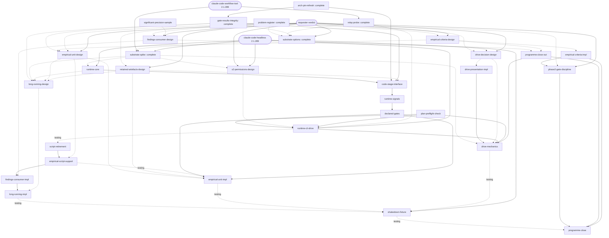

# Breakdown: LSF improvements

## Summary

A programme to investigate and act on the friction recorded in the [archipeligo postmortem](../design/lsf-postmortem-archipeligo-foundation.md). 32 units, six complete; critical path 11 units through the S2 build and the serialised orchestrator stream. Base commit `b3dac6a`.

The postmortem's problems are taken as accurate for archipeligo. The proposals in [lsf-improvements](../design/lsf-improvements.md) are candidate options, not designs: every decision unit states its problem without a solution, checks whether the problem holds outside archipeligo, and weighs the proposal against alternatives that include doing nothing.

The programme is complete when every row of the problem register has a disposition (fixed, with the commit; declined, with the reason; or deferred to a named successor), the `workflows/lsf` tests pass, and the shakedown fixture runs to `complete`.

The substrate is S2, a host runtime running the orchestrator through headless `claude -p` calls, confirmed by `substrate-spike`. The Workflow script stays the supported Phase 3 path, under `lsf-substrate.md`'s interim policy, until `script-retirement`.

Key risks: the S2 build is a conjectured estimate and leads the critical path; seven design units wait on a requester verdict, so requester attention, not agent time, bounds the schedule; and the evidence for generality is one other project (cartomancer-v2), all code units.

Units marked **provisional** have entries the re-plan rewrites when the design unit they depend on completes. A design that declines to act retires its provisional units, with the reason in the register.

## Work Units

### problem-register — complete at `f10f9d5`; entry at `f3a395a`; report `docs/plans/problem-register-completion.md`

### relay-probe — complete at `ff1a49f`; entry at `83bebd1`; report `docs/investigations/relay-probe-results.md`

### substrate-options — complete at `8d22932`; entry at `5d5842f`; report `docs/design/lsf-substrate.md`

### substrate-spike — complete at `23b38d4`; entry at `e2db84f`; report `docs/investigations/substrate-spike-results.md`

### arch-pin-refresh — complete at `382b5e2`; entry at `0cacac9`; report `docs/plans/arch-pin-refresh-completion.md`

### gate-results-integrity — complete at `efc7658`; entry at `c901531`; report `docs/plans/gate-results-integrity-completion.md`

### plan-preflight-check
- **Type**: feature
- **Risk**: low — the checks exist in `graph.js` and `scheduling.js`
- **Clarity**: specified
- **Iteration**: write-once
- **Effort**: medium
- **Scope**: `workflows/lsf/validate.js`, `workflows/lsf/test/validate.test.js`, `skills/breakdown/SKILL.md::quality-check`, `skills/lsf-drive/SKILL.md::startup`
- **Publishes**: a plan-validation command runnable outside a workflow
- **Depends on**: none
- **External gates**: `node` (environment, v26.9.0)
- **Done condition**: A command runnable outside a workflow exits non-zero, printing the load stage's problems, on fixtures for an unserialised overlap, a cycle, a bad `clears` entry and a block that disagrees with its entries, and exits zero on this plan. `phronithm:breakdown` and `phronithm:lsf-drive` name it where a plan is committed and where one is launched. The tests pass.
- **Description**: Postmortem §D "Plan checks only at load": two plans fresh from breakdown stopped at load. The check is independent of the substrate decision, since both a script and a driver need it before launch.

### significant-precision-sample
- **Type**: design
- **Risk**: medium — a hand classification; the rubric decides the answer
- **Clarity**: specified
- **Iteration**: write-once
- **Effort**: medium
- **Scope**: `docs/investigations/lsf-significant-precision.md`
- **Publishes**: a precision estimate for sub-Critical findings, by source stage and project
- **Depends on**: none
- **External gates**: `archipeligo-records` (data, `~/src/archipeligo-evolved` @ `c220c62`, 21 ledgers); `cartomancer-records` (data, `quality-bar-interiors-signals.md`, 1.3 MB)
- **Done condition**: The record is committed with the sampling frame, sample size and classification rubric fixed before any row is classified and stated as such; ledger rows deduplicated into findings; and a precision estimate with an interval per source stage (plan critique, code critique, lens review) for each project. `phronithm:critique` passes at the gate bar.
- **Description**: Postmortem §B and its data gap: Significant-finding precision is unmeasured. Run with `phronithm:investigate`. Without it, any consumer for these findings is chosen blind.

### empirical-criteria-design
- **Type**: design
- **Risk**: high — changes what Phases 1–2 demand of every programme
- **Clarity**: exploratory
- **Iteration**: write-once
- **Effort**: medium
- **Scope**: `docs/design/lsf-empirical-work.md::criteria`
- **Publishes**: the decided requirements on measured success criteria, cited evidence, and the criterion-against-vision check
- **Depends on**: problem-register (knowledge, problem ids and generality classes)
- **External gates**: `archipeligo-records` (data, `~/src/archipeligo-evolved` @ `c220c62`); `cartomancer-records` (data, `~/src/cartomancer-v2` quality-bar-interiors brief and plans); `requester-verdict` (organisational)
- **Done condition**: The Criteria section is committed. It decides what Phases 1–2 require of a success criterion judged by measurement and of evidence cited for an architecture claim, and how a criterion is checked against the vision it stands for. It is walked against archipeligo's three cases (the 3-seed gate, the 41-seed gate, the undefined "persists") and against cartomancer-v2's `quality-bar-interiors`, stating the burden it adds to a programme with no measured criterion. The requester's verdict is recorded.
- **Description**: Postmortem §A (gate designs, evidence from another system, an undefined criterion, a criterion that did not test the vision) and §G.

### empirical-unit-design
- **Type**: design
- **Risk**: high — `phronithm:breakdown` is used outside lsf, so a change here reaches every plan
- **Clarity**: exploratory
- **Iteration**: write-once
- **Effort**: medium
- **Scope**: `docs/design/lsf-empirical-work.md::units`
- **Publishes**: the decided plan-level shape of empirical work
- **Depends on**: problem-register (knowledge, problem ids and generality classes); empirical-criteria-design (design, the criteria form a unit's registration cites); gate-results-integrity (knowledge, an empty gates list stops with `gate-not-run`)
- **External gates**: `archipeligo-records` (data, `~/src/archipeligo-evolved` @ `c220c62`); `requester-verdict` (organisational)
- **Done condition**: The Units section is committed. It decides how a plan represents work whose outcome is a measurement, comparing at least a new unit type, added entry fields, and routing the work to `phronithm:investigate`. It covers fail branches (P-A4), the risk and clarity rating of sampled work (P-A5), companion tuning units (P-A6), sizing under outcome uncertainty (P-A9), and a measurement that supersedes cited evidence without moving a decision (P-A10). It decides what a non-design unit declares as its gate in a project with no gate of its own, for measurement and docs units, since an empty gates list stops with `gate-not-run`. It is walked against `stage1-gate` at `arch@dc88280` and `stage2-horizon-confirm`. The requester's verdict is recorded.
- **Description**: Postmortem §A's unit-level bullets: campaigns typed `feature` or `integration`, units sized by context and not by outcome uncertainty, measured values accumulating in the architecture document.

### retained-artefacts-design
- **Type**: design
- **Risk**: medium — what a record may cite as must-keep binds every unit that produces data
- **Clarity**: exploratory — one open decision: what a record may cite as must-keep
- **Iteration**: write-once
- **Effort**: medium
- **Scope**: `docs/design/lsf-empirical-work.md::retained-artefacts`
- **Publishes**: the decided retained-artefact policy
- **Depends on**: problem-register (knowledge, P-D5)
- **External gates**: `archipeligo-records` (data, `~/src/archipeligo-evolved` @ `c220c62`); `archipeligo-runs` (data, `~/src/archipeligo-runs`, 80 GB on 2026-10-04); `requester-verdict` (organisational)
- **Done condition**: The Retained artefacts section is committed. It decides what a record may cite as must-keep: it weighs regeneration cost against storage cost, compares a record citing a regeneration recipe (commit plus command) with one citing a retained path (a run directory outside the checkout, or a worktree), and holds on a substrate that offers no storage outside the worktree (exemplar `~/src/maths-proofs/tools/campaign/`). It is walked against P-D5's three records (`horizon.md`, `bid-era.md`, `trigger.md`) and the 80 GB and 372 MB worktree they keep. The requester's verdict is recorded.
- **Description**: P-D5. The re-plan after it names the units that carry the policy; `empirical-unit-impl` and `long-running-design` consume it by default.

### findings-consumer-design
- **Type**: design
- **Risk**: high — may change the stop rule's convergence and no-volume principles
- **Clarity**: exploratory
- **Iteration**: write-once
- **Effort**: medium
- **Scope**: `docs/design/lsf-findings.md`
- **Publishes**: the decision on whether, and by which stage, sub-Critical findings are consumed
- **Depends on**: significant-precision-sample (knowledge, precision estimate); problem-register (knowledge, problem ids and generality classes)
- **External gates**: `requester-verdict` (organisational)
- **Done condition**: `docs/design/lsf-findings.md` is committed. It decides what happens to a finding below Critical, with "surface its text, add no consumer" among the options, cites the measured precision, and states the effect of the choice on the Critical-only convergence bar and on "no volume or recurrence rules". The requester's verdict is recorded.
- **Description**: Postmortem §B: findings below Critical are recorded and read by no stage; two came true unaddressed and the requester patched the gap by hand twice.

### drive-decision-design
- **Type**: design
- **Risk**: high — changes the session role the design records ("a presenter and relauncher, any model tier")
- **Clarity**: exploratory
- **Iteration**: write-once
- **Effort**: medium
- **Scope**: `docs/design/lsf-session-role.md`
- **Publishes**: the decided session role at a stop
- **Depends on**: problem-register (knowledge, problem ids and generality classes); substrate-options (design, the session's duties differ by substrate)
- **External gates**: `requester-verdict` (organisational)
- **Done condition**: `docs/design/lsf-session-role.md` is committed. It decides what analysis precedes a question to the requester, when a recommendation may be made and what it must state, the model tier, the route from repeated stops to an investigation, and whether gates may be cleared ahead of the stop. It is replayed against postmortem §E's four cases (the 41-seed question, "Keep baseline", the three stage-1 stops, the three pre-clearable gates). Since P-E1, P-E3 to P-E7 and P-E9 also occurred on cartomancer-v2 in sessions driven without `phronithm:lsf-drive`, it states whether the decided role binds only `phronithm:lsf-drive` or any session driving a run. The requester's verdict is recorded.
- **Description**: Postmortem §E "Compressed decisions", "A recommendation without its basis", "Options inside a failing frame" and "Pre-clearable gates".

### s2-permissions-design
- **Type**: design
- **Risk**: medium — the spike's deny list is bypassable, and the alternatives are untested or edit the orchestrator
- **Clarity**: exploratory — one open decision: the per-stage permission configuration
- **Iteration**: write-once
- **Effort**: medium
- **Scope**: `docs/design/lsf-runtime.md::permissions`
- **Publishes**: the per-stage permission configuration
- **Depends on**: substrate-spike (knowledge, run 1's prefix-rule failure and the deny list of runs 2–7)
- **External gates**: `claude-code-headless` (environment, Claude Code 2.1.289); `requester-verdict` (organisational)
- **Done condition**: The Permissions section is committed. It decides each stage role's permission configuration, comparing at least a deny list with Bash granted, prompts rewritten to single commands, and `--permission-mode auto`. Each option is run on the spike fixture: whether an implement stage completes, and whether a probe agent told to edit `.claude/settings.json` and delete a branch by shell is stopped, recorded per option. It states what a reviewer role may write. The requester's verdict is recorded.
- **Description**: Spike condition 3; P-C5, P-C6. The spike's deny list held on agent restraint, not enforcement (results, check 9).

### runtime-core
- **Type**: foundation
- **Risk**: high — every later script unit runs on it
- **Clarity**: specified
- **Iteration**: write-once
- **Effort**: large
- **Scope**: `workflows/lsf/runtime/`, `workflows/lsf/test/runtime.test.js`, `docs/design/lsf-runtime.md::runtime`
- **Publishes**: the host runtime `{ agent, parallel, log, args }` for `run(runtime)`; the journal; stage roles as configuration
- **Depends on**: substrate-spike (knowledge, the spike driver and its adapter requirements)
- **External gates**: `node` (environment, v26.9.0); `claude-code-headless` (environment, Claude Code 2.1.289)
- **Done condition**: Tests against a stub `claude` binary show that: a missing or schema-invalid `structured_output` after a clean exit is retried once, then null; a transient error is retried with backoff, a session-limit error waits for its reset, and a permanent one (`unrecognized_model`) is not retried; a prompt naming a skill is sent as its slash command, and a call whose stream shows no skill load is retried or flagged; `--strict-mcp-config` and the role's toolset are passed; a resume replays completed calls and journaled code steps without re-running them; and children left by a SIGKILL during concurrent calls are terminated by the next launch. Role permissions are an input, not constants. The tests pass.
- **Description**: The spike's adapter (`workflows/lsf/spike/driver.js`; results, Adapter requirements), rebuilt with tests. The code stages are `code-stage-interface`'s.

### code-stage-interface
- **Type**: refactor
- **Risk**: high — moves six stages out of agents; P-C1 to P-C4, P-C8 and P-C9 rest on it
- **Clarity**: exploratory — one open decision: the interface's shape (`rt.code.*` hooks or typed stage calls)
- **Iteration**: write-once
- **Effort**: large
- **Scope**: `workflows/lsf/implement.js`, `workflows/lsf/test/implement.test.js`, `workflows/lsf/runtime/stages.js`, `workflows/lsf/test/stages.test.js`, `workflows/lsf-implement.js`, `docs/design/lsf-workflow.md::model-tiers`
- **Publishes**: the orchestrator's code-stage interface
- **Depends on**: runtime-core (logical, the runtime); arch-pin-refresh (logical, the merge stage's `architectureSha` and `merges[].sha`); gate-results-integrity (logical, serialises `implement.js`); retained-artefacts-design (design, which ignored files cleanup may delete)
- **External gates**: `node` (environment, v26.9.0)
- **Done condition**: Load, decision log, ledger append, completion report, merge with its plan bookkeeping, and cleanup run as code through the interface; their agent prompts stay as the Workflow script's path until `script-retirement`. Tests inject at each stage the faults P-C1 to P-C4 and their Appendix B probes record — a placeholder, truncation, overwritten or deleted rows, an append's own rows altered or its heading dropped, a dropped line or fence, an invented `clears` entry — and a rejected commit, and show none is committed or accepted silently. A merge conflict goes to a model call and an unresolvable one is reported. A returned SHA that does not resolve, including `architectureSha` and each `merges[].sha`, is rejected, and a clean merge without its SHA is not attributed to the whole wave. A kill between the merge step's commit and its record resumes with no second merge or bookkeeping commit. Cleanup keeps a worktree holding ignored files unless the retained-artefact policy names them rebuildable. The tests pass and the built script is not stale.
- **Description**: Replaces `mechanical-stage-integrity`. The spike's code stages parse their inputs out of prompt text (results, Build estimate); the interface passes them as values. **Flag:** six stages exceed the planned-steps bound; the spike's code for each is the behavioural reference, so the excess is not context.

### runtime-signals
- **Type**: feature
- **Risk**: medium
- **Clarity**: exploratory — one open decision: which driver-detected events stop the run
- **Iteration**: write-once
- **Effort**: medium
- **Scope**: `workflows/lsf/schema.js`, `workflows/lsf/scheduling.js`, `workflows/lsf/runtime/`, `workflows/lsf/test/scheduling.test.js`, `workflows/lsf/test/runtime.test.js`, `workflows/lsf-implement.js`, `docs/design/lsf-workflow.md::escalation`
- **Publishes**: driver-event signal kinds
- **Depends on**: code-stage-interface (logical, serialises the runtime and orchestrator files)
- **External gates**: `node` (environment, v26.9.0)
- **Done condition**: A corrected SHA, a permission denial, uncommitted changes at a stage's return, a gate the agent omitted, and a skill not loaded each reach the ledger as a signal, and the decided ones stop the run. Tests reproduce postmortem §C's permission faults (a denied commit reported with HEAD as its SHA; a denied branch delete) and run #2's transient null, and show none yields its recorded outcome. A `gate-not-run` stop is not retried (requester decision, 2026-10-05). The tests pass and the built script is not stale.
- **Description**: Replaces `stage-failure-handling`. In the spike these events reached telemetry only.

### declared-gates
- **Type**: feature
- **Risk**: medium — a plan-format change reaches every plan
- **Clarity**: exploratory — one open decision: whether gate commands are declared in the plan block or in project configuration
- **Iteration**: write-once
- **Effort**: medium
- **Scope**: `workflows/lsf/graph.js`, `workflows/lsf/test/graph.test.js`, `workflows/lsf/runtime/`, `workflows/lsf-implement.js`, `docs/plan-graph.md`, `skills/breakdown/SKILL.md::graph`, `docs/design/lsf-workflow.md::lifecycle-mapping`
- **Publishes**: the declared gate-command field
- **Depends on**: runtime-signals (logical, serialises the runtime files; the omitted-gate signal)
- **External gates**: `node` (environment, v26.9.0)
- **Done condition**: A project's gate commands are declared where the unit decides. The runtime runs them on a clean checkout of the returned commit after implement, after each code fix and after each merge, and the reviewers read its results. Tests show a stage that reports `green` for a gate it did not run, or omits one, is caught. `phronithm:breakdown` emits the declaration. The tests pass and the built script is not stale.
- **Description**: Closes R11 (results, check 10b).

### runtime-cli-drive
- **Type**: integration
- **Risk**: medium
- **Clarity**: exploratory — one open decision: how pause and status are exposed (pause ref, kill file, state file)
- **Iteration**: write-once
- **Effort**: medium
- **Scope**: `workflows/lsf/runtime/cli.js`, `workflows/lsf/test/cli.test.js`, `skills/lsf-drive/SKILL.md::launch`, `skills/lsf-drive/SKILL.md::relaunch`, `skills/lsf-drive/SKILL.md::startup`, `docs/design/lsf-runtime.md::cli`
- **Publishes**: the runtime CLI (launch, status, pause, resume, watch)
- **Depends on**: declared-gates (logical, serialises the runtime files); s2-permissions-design (design, the decided configuration); plan-preflight-check (logical, serialises `skills/lsf-drive/SKILL.md::startup`); relay-probe (knowledge, relay behaviour)
- **External gates**: `claude-code-headless` (environment, Claude Code 2.1.289); `node` (environment, v26.9.0)
- **Done condition**: `phronithm:lsf-drive` launches, pauses, resumes and reads the status of a run through the CLI, under the decided permission configuration. A fixture run launched from a turn in which the requester typed a message shows no agent transcript carrying a relayed message, cited by transcript (P-F1). The driver outlives the interactive session that launched it, or the skill says it runs from the requester's terminal. The Relaunch section keeps `gate-not-run`'s route: an environment or project change, not a decision. The tests pass.
- **Description**: Replaces `relay-mitigation`: headless calls carry no relay (results, check 3), so P-F1 reduces to the launch path.

### script-retirement
- **Type**: refactor
- **Risk**: low
- **Clarity**: specified
- **Iteration**: write-once
- **Effort**: small
- **Scope**: `workflows/lsf-implement.js`, `workflows/lsf/build.js`, `workflows/lsf/test/build.test.js`, `workflows/lsf/spike/`, `workflows/lsf/implement.js`, `docs/design/lsf-workflow.md::constraints`, `CLAUDE.md`
- **Publishes**: none
- **Depends on**: runtime-cli-drive (testing, the replacement path runs through `phronithm:lsf-drive`)
- **External gates**: none
- **Done condition**: The generated script, `build.js`, its test, the spike directory and the mechanical stages' agent prompts are deleted. `lsf-workflow.md`'s Constraints section describes the runtime, not the Workflow tool. `CLAUDE.md`'s Structure section names the runtime and no longer the generated script. `cd workflows/lsf && node --test test/` passes.
- **Description**: Ends `lsf-substrate.md`'s interim policy: the Workflow script is the supported Phase 3 path until this unit.

### empirical-script-support
- **Type**: feature
- **Risk**: medium — provisional on `empirical-unit-design`
- **Clarity**: exploratory
- **Iteration**: write-once
- **Effort**: medium
- **Scope**: `workflows/lsf/implement.js`, `workflows/lsf/graph.js`, `workflows/lsf/schema.js`, `workflows/lsf/test/implement.test.js`, `workflows/lsf/test/graph.test.js`, `workflows/lsf/test/schema.test.js`, `docs/design/lsf-workflow.md::wave-loop`
- **Publishes**: the plan-block fields and gate behaviour the empirical design decided
- **Depends on**: empirical-unit-design (design, plan-level shape); script-retirement (logical, serialises the orchestrator files)
- **External gates**: `node` (environment, v26.9.0)
- **Done condition**: Tests show the parser accepts every plan-block field the empirical design adds, that a measurement superseding a cited figure with no decision moved is handled as the design decided, and that a non-design unit in a project with no gate of its own reaches review with the gate the design decided. The tests pass.
- **Description**: **Provisional.** Retired if the design routes empirical work outside the plan block and leaves the gate unchanged.

### findings-consumer-impl
- **Type**: feature
- **Risk**: medium — provisional on `findings-consumer-design`
- **Clarity**: exploratory
- **Iteration**: write-once
- **Effort**: medium
- **Scope**: `workflows/lsf/implement.js`, `workflows/lsf/scheduling.js`, `workflows/lsf/test/implement.test.js`, `workflows/lsf/test/scheduling.test.js`, `docs/design/lsf-workflow.md::escalation`
- **Publishes**: finding identity across review rounds
- **Depends on**: findings-consumer-design (design, the decided consumer); empirical-script-support (logical, serialises the script files)
- **External gates**: `node` (environment, v26.9.0)
- **Done condition**: Tests show each unfixed Significant finding reaches the decided destination once, however many review rounds repeat it, with its text and referent. The tests pass.
- **Description**: **Provisional.** Postmortem §B.

### long-running-design
- **Type**: design
- **Risk**: high — the wave barrier, re-plan and resume all assume a unit ends with its stage
- **Clarity**: exploratory
- **Iteration**: write-once
- **Effort**: large
- **Scope**: `docs/design/lsf-long-running.md`
- **Publishes**: the decision on work that outlasts a stage
- **Depends on**: substrate-spike (design, confirmed substrate); runtime-core (knowledge, the runtime's supervision of its calls); empirical-unit-design (design, plan-level shape); retained-artefacts-design (design, retained-artefact policy for a job's outputs); gate-results-integrity (knowledge, the `gate-not-run` stop and the long-gate recipe)
- **External gates**: none
- **Done condition**: `docs/design/lsf-long-running.md` is committed. It decides how work that outlasts one agent stage runs under the host runtime, and states the behaviour of the wave barrier, a re-plan while the work is in flight, resume, liveness, and a process left behind by a stopped run. On resume it distinguishes an interrupted attempt from one a re-plan or decision superseded, and states what happens to the interrupted attempt's commits and untracked outputs. It states the route for a project gate that cannot finish within one stage even with the long-gate recipe, which now stops with `gate-not-run` and has no exit through the workflow. `phronithm:critique` (critique-design) passes at the gate bar.
- **Description**: Postmortem §A: 18 campaign stages took 39.7 of 62.1 implement agent-hours; one campaign outlived its stage and left an orphan process.

### long-running-impl
- **Type**: feature
- **Risk**: high — provisional on `long-running-design`
- **Clarity**: exploratory
- **Iteration**: iterative (structural)
- **Effort**: large
- **Scope**: `workflows/lsf/implement.js`, `workflows/lsf/scheduling.js`, `workflows/lsf/test/implement.test.js`, `workflows/lsf/test/scheduling.test.js`, `workflows/lsf/runtime/`, `docs/design/lsf-workflow.md::wave-loop`, `docs/design/lsf-workflow.md::lifecycle-mapping`
- **Publishes**: none
- **Depends on**: long-running-design (design, the decision); findings-consumer-impl (logical, serialises the orchestrator files)
- **External gates**: `node` (environment, v26.9.0)
- **Done condition**: A test shows a unit whose job outlasts its launching stage completes with its results reviewed, and that a stopped run leaves no process the run has no record of. A test shows that resuming a run treats an interrupted implement attempt's commits and untracked outputs as `long-running-design` decided (P-D6), and that a project gate outlasting its stage takes the route it decided. The tests pass.
- **Description**: **Provisional.** The re-plan after `long-running-design` splits this unit if the decision spans more than the orchestrator and runtime.

### empirical-criteria-impl
- **Type**: feature
- **Risk**: low
- **Clarity**: specified
- **Iteration**: write-once
- **Effort**: small
- **Scope**: `skills/large-scale-feature/SKILL.md::phase-1`, `skills/large-scale-feature/SKILL.md::phase-2`
- **Publishes**: none
- **Depends on**: empirical-criteria-design (design, decided requirements)
- **External gates**: none
- **Done condition**: `skills/large-scale-feature/SKILL.md` Phases 1–2 carry the decided requirements. `phronithm:critique` (critique-skill) passes at the gate bar and a `phronithm:edit` pass has been applied.
- **Description**: **Provisional.**

### phase2-gate-discipline
- **Type**: feature
- **Risk**: medium — the adversary's measured recall at sonnet is 0/14; the opus re-run `critique-gate.md` waits on is outside this plan
- **Clarity**: exploratory — one open decision: what lsf says about an adversarial pass before that re-run exists
- **Iteration**: write-once
- **Effort**: small
- **Scope**: `skills/large-scale-feature/SKILL.md::phase-2`, `docs/critique-gate.md`
- **Publishes**: none
- **Depends on**: problem-register (knowledge, problem ids and generality classes); empirical-criteria-impl (logical, serialises the Phase 2 section)
- **External gates**: `requester-verdict` (organisational)
- **Done condition**: Phase 2 and its re-entry sub-procedure state the decided policy on an adversarial pass, consistent with `critique-gate.md`'s reinstatement condition, and state when a review instrument produced in Phase 1 is run. `phronithm:critique` (critique-skill) passes at the gate bar. The requester's verdict on the adversary policy is recorded.
- **Description**: Postmortem §G: the one re-entry gated by a sonnet critic alone passed a design reversed about 25 h later; a Phase 1 instrument first ran as Phase 3's first unit and forced four amendment rounds.

### empirical-unit-impl
- **Type**: feature
- **Risk**: medium — provisional on `empirical-unit-design`
- **Clarity**: specified
- **Iteration**: write-once
- **Effort**: medium
- **Scope**: `skills/breakdown/SKILL.md`, `docs/plan-graph.md`
- **Publishes**: none
- **Depends on**: empirical-unit-design (design, plan-level shape); retained-artefacts-design (design, retained-artefact policy); empirical-script-support (testing, the parser must accept what the skill emits); plan-preflight-check, declared-gates (logical, each serialises a section of `skills/breakdown/SKILL.md`; declared-gates also `docs/plan-graph.md`)
- **External gates**: none
- **Done condition**: `skills/breakdown/SKILL.md` and `docs/plan-graph.md` carry the decided shape, and the retained-artefact policy wherever that decision places it in them. A fixture plan written to it passes the pre-flight command. `phronithm:critique` (critique-skill) passes at the gate bar and a `phronithm:edit` pass has been applied.
- **Description**: **Provisional.**

### programme-close-out
- **Type**: feature
- **Risk**: medium
- **Clarity**: exploratory — one open decision: what a programme-level close consists of
- **Iteration**: write-once
- **Effort**: medium
- **Scope**: `skills/large-scale-feature/SKILL.md::termination`, `skills/lsf-drive/SKILL.md::termination`
- **Publishes**: none
- **Depends on**: findings-consumer-design (design, what an unfixed finding is at close); empirical-criteria-design (design, the criterion-against-vision check)
- **External gates**: `archipeligo-records` (data, `~/src/archipeligo-evolved` @ `c220c62`)
- **Done condition**: Both Termination sections define a programme-level close: a review of what was delivered against the request record and the vision, and an audit of unfixed findings over every unit. Walked against archipeligo's close-out, the step as written covers the 26 review-stage rows that audit missed and prompts the vision review the requester had to ask for. `phronithm:critique` (critique-skill) passes at the gate bar.
- **Description**: Postmortem §B's last two paragraphs.

### drive-presentation-impl
- **Type**: feature
- **Risk**: medium — provisional on `drive-decision-design`
- **Clarity**: specified
- **Iteration**: write-once
- **Effort**: medium
- **Scope**: `skills/lsf-drive/SKILL.md::present`, `skills/lsf-drive/SKILL.md::decide`, `docs/design/lsf-workflow.md::architecture`
- **Publishes**: none
- **Depends on**: drive-decision-design (design, decided session role)
- **External gates**: none
- **Done condition**: `phronithm:lsf-drive`'s Present and Decide sections and the design's Session paragraph agree with `docs/design/lsf-session-role.md`. `phronithm:critique` (critique-skill) passes at the gate bar and a `phronithm:edit` pass has been applied.
- **Description**: **Provisional.**

### drive-mechanics
- **Type**: feature
- **Risk**: medium — several small rules in an 18 KB skill; the over-budget step count is flagged below
- **Clarity**: exploratory — the driving duties depend on the substrate
- **Iteration**: write-once
- **Effort**: medium
- **Scope**: `skills/lsf-drive/SKILL.md`
- **Publishes**: none
- **Depends on**: substrate-spike (design, confirmed substrate); drive-decision-design (design, whether driving rules bind only `phronithm:lsf-drive`); drive-presentation-impl, runtime-cli-drive, plan-preflight-check, programme-close-out (logical, each serialises a section of `skills/lsf-drive/SKILL.md`)
- **External gates**: none
- **Done condition**: For each of P-E1, P-E6, P-E7, P-E8, P-E9 and P-I1, `phronithm:lsf-drive` carries a rule or the unit's completion report gives the register row a `declined` disposition with the reason. The Relaunch section keeps `gate-not-run`'s route. The skill's byte size before and after is reported. `phronithm:critique` (critique-skill) passes at the gate bar and a `phronithm:edit` pass has been applied.
- **Description**: About 60% of requester inputs in the first week were mechanics. The unit first asks which duties the runtime CLI removes, and adds rules only for those that remain. **Flag:** up to seven items exceeds the planned-steps bound; each is a few lines of skill text in one file, so the excess is not context.

### shakedown-fixture
- **Type**: integration
- **Risk**: medium — a live run; depends on every script unit
- **Clarity**: exploratory — one open decision: where the fixture lives (this repository or `~/src/critic-fidelity-bench`)
- **Iteration**: iterative (structural)
- **Effort**: medium
- **Scope**: `workflows/lsf/test/fixtures/shakedown/`, `docs/design/lsf-workflow.md::status`, `docs/design/lsf-workflow.md::testing`
- **Publishes**: a fixture plan covering the unit kinds the runtime claims to run
- **Depends on**: long-running-impl (testing, the last script unit); empirical-unit-impl (testing, the plan form); drive-mechanics (testing, the launch path)
- **External gates**: `claude-code-headless` (environment, Claude Code 2.1.289)
- **Done condition**: The runtime, launched through `phronithm:lsf-drive` on a fixture plan with at least one code unit whose gate runs past the 600 s tool timeout, one design unit that settles a decision the architecture document left open, and one empirical unit whose job outlasts the tool timeout, returns `complete`, with the design unit's change recorded as an architecture amendment. A second run, on a variant whose unit moves a decision the document made, stops with `architecture-invalidated`. The design's Status section cites both run ids, lists the unit kinds the runtime has run on, and records how the long gate completed.
- **Description**: Postmortem §G: the workflow was shaken down on code units and met measurement units first on a live programme. The two architecture cases are the upgrade path for the gate half of `arch-pin-refresh`'s done condition, and the long gate for `gate-results-integrity`'s live long-gate claim; both were `conjectured` at completion. **Flag:** the scope path moves if the fixture lives in the bench repository.

### programme-close
- **Type**: integration
- **Risk**: low
- **Clarity**: specified
- **Iteration**: write-once
- **Effort**: small
- **Scope**: `docs/design/lsf-problem-register.md`, `docs/design/lsf-improvements.md`, `docs/design/lsf-workflow.md::status`, `CLAUDE.md`
- **Publishes**: none
- **Depends on**: shakedown-fixture (testing, the run); phase2-gate-discipline, programme-close-out, empirical-criteria-impl (logical, their dispositions)
- **External gates**: none
- **Done condition**: Every register row has a disposition: `fixed` with a commit, `declined` with a reason, or `deferred` to a named successor. `docs/design/lsf-improvements.md` is deleted. `CLAUDE.md`'s Structure section lists the documents and commands the programme added. `cd workflows/lsf && node --test test/` passes.
- **Description**: The closure unit: it owns the completeness criterion the other units contribute to (Standing Obligations).

## Graph

```yaml lsf-plan
units:
  - id: problem-register
    type: foundation
    complete: true
    dependencies: []
    scope: [docs/design/lsf-problem-register.md]
    publishes: [problem ids, generality classes, topic tags]
    gates:
      - name: archipeligo-records
        kind: data
        pin: "archipeligo-evolved c220c62"
      - name: cartomancer-records
        kind: data
        pin: "quality-bar-interiors-signals.md; transcripts from 2026-09-10"
  - id: relay-probe
    type: design
    complete: true
    dependencies: []
    scope: [docs/design/lsf-workflow.md::constraints]
    publishes: [relay behaviour]
    gates:
      - name: claude-code-workflow-tool
        kind: environment
        pin: "2.1.289"
  - id: substrate-options
    type: design
    complete: true
    dependencies: [problem-register, relay-probe, gate-results-integrity]
    scope: [docs/design/lsf-substrate.md]
    publishes: [selected option, interim script policy]
    gates:
      - name: requester-verdict
        kind: organisational
  - id: substrate-spike
    type: design
    complete: true
    dependencies: [substrate-options]
    scope: [docs/design/lsf-substrate.md, workflows/lsf/spike]
    publishes: [confirmed substrate]
    gates:
      - name: claude-code-workflow-tool
        kind: environment
        pin: "2.1.289"
      - name: claude-code-headless
        kind: environment
        pin: "2.1.289"
      - name: node
        kind: environment
        pin: "v26.9.0"
  - id: arch-pin-refresh
    type: bug-fix
    complete: true
    dependencies: []
    scope: [workflows/lsf/implement.js, workflows/lsf/scheduling.js, workflows/lsf/schema.js, workflows/lsf/test/implement.test.js, workflows/lsf/test/scheduling.test.js, workflows/lsf-implement.js, docs/design/lsf-workflow.md::wave-loop]
    publishes: [merge-stage architectureSha and merges sha, gate amendments]
    gates:
      - name: node
        kind: environment
        pin: "v26.9.0"
  - id: gate-results-integrity
    type: bug-fix
    complete: true
    dependencies: [arch-pin-refresh]
    scope: [workflows/lsf/implement.js, workflows/lsf/schema.js, workflows/lsf/test/implement.test.js, workflows/lsf-implement.js, docs/design/lsf-workflow.md::lifecycle-mapping, skills/lsf-drive/SKILL.md::relaunch]
    publishes: [fix return shape, gate-not-run stop, long-gate recipe, P-D3 residual]
    gates:
      - name: node
        kind: environment
        pin: "v26.9.0"
  - id: plan-preflight-check
    type: feature
    complete: false
    dependencies: []
    scope: [workflows/lsf/validate.js, workflows/lsf/test/validate.test.js, skills/breakdown/SKILL.md::quality-check, skills/lsf-drive/SKILL.md::startup]
    publishes: [plan-validation command]
    gates:
      - name: node
        kind: environment
        pin: "v26.9.0"
  - id: significant-precision-sample
    type: design
    complete: false
    dependencies: []
    scope: [docs/investigations/lsf-significant-precision.md]
    publishes: [precision estimate]
    gates:
      - name: archipeligo-records
        kind: data
        pin: "archipeligo-evolved c220c62"
      - name: cartomancer-records
        kind: data
        pin: "quality-bar-interiors-signals.md"
  - id: empirical-criteria-design
    type: design
    complete: false
    dependencies: [problem-register]
    scope: [docs/design/lsf-empirical-work.md::criteria]
    publishes: [criteria requirements]
    gates:
      - name: archipeligo-records
        kind: data
        pin: "archipeligo-evolved c220c62"
      - name: cartomancer-records
        kind: data
        pin: "quality-bar-interiors brief and plans"
      - name: requester-verdict
        kind: organisational
  - id: empirical-unit-design
    type: design
    complete: false
    dependencies: [problem-register, empirical-criteria-design, gate-results-integrity]
    scope: [docs/design/lsf-empirical-work.md::units]
    publishes: [empirical work plan shape]
    gates:
      - name: archipeligo-records
        kind: data
        pin: "archipeligo-evolved c220c62"
      - name: requester-verdict
        kind: organisational
  - id: retained-artefacts-design
    type: design
    complete: false
    dependencies: [problem-register]
    scope: [docs/design/lsf-empirical-work.md::retained-artefacts]
    publishes: [retained-artefact policy]
    gates:
      - name: archipeligo-records
        kind: data
        pin: "archipeligo-evolved c220c62"
      - name: archipeligo-runs
        kind: data
        pin: "~/src/archipeligo-runs, 80 GB on 2026-10-04"
      - name: requester-verdict
        kind: organisational
  - id: findings-consumer-design
    type: design
    complete: false
    dependencies: [significant-precision-sample, problem-register]
    scope: [docs/design/lsf-findings.md]
    publishes: [findings consumer decision]
    gates:
      - name: requester-verdict
        kind: organisational
  - id: drive-decision-design
    type: design
    complete: false
    dependencies: [problem-register, substrate-options]
    scope: [docs/design/lsf-session-role.md]
    publishes: [session role]
    gates:
      - name: requester-verdict
        kind: organisational
  - id: s2-permissions-design
    type: design
    complete: false
    dependencies: [substrate-spike]
    scope: [docs/design/lsf-runtime.md::permissions]
    publishes: [per-stage permission configuration]
    gates:
      - name: claude-code-headless
        kind: environment
        pin: "2.1.289"
      - name: requester-verdict
        kind: organisational
  - id: runtime-core
    type: foundation
    complete: false
    dependencies: [substrate-spike]
    scope: [workflows/lsf/runtime, workflows/lsf/test/runtime.test.js, docs/design/lsf-runtime.md::runtime]
    publishes: [host runtime, journal, stage roles as configuration]
    gates:
      - name: node
        kind: environment
        pin: "v26.9.0"
      - name: claude-code-headless
        kind: environment
        pin: "2.1.289"
  - id: code-stage-interface
    type: refactor
    complete: false
    dependencies: [runtime-core, arch-pin-refresh, gate-results-integrity, retained-artefacts-design]
    scope: [workflows/lsf/implement.js, workflows/lsf/test/implement.test.js, workflows/lsf/runtime/stages.js, workflows/lsf/test/stages.test.js, workflows/lsf-implement.js, docs/design/lsf-workflow.md::model-tiers]
    publishes: [code-stage interface]
    gates:
      - name: node
        kind: environment
        pin: "v26.9.0"
  - id: runtime-signals
    type: feature
    complete: false
    dependencies: [code-stage-interface]
    scope: [workflows/lsf/schema.js, workflows/lsf/scheduling.js, workflows/lsf/runtime, workflows/lsf/test/scheduling.test.js, workflows/lsf/test/runtime.test.js, workflows/lsf-implement.js, docs/design/lsf-workflow.md::escalation]
    publishes: [driver-event signal kinds]
    gates:
      - name: node
        kind: environment
        pin: "v26.9.0"
  - id: declared-gates
    type: feature
    complete: false
    dependencies: [runtime-signals]
    scope: [workflows/lsf/graph.js, workflows/lsf/test/graph.test.js, workflows/lsf/runtime, workflows/lsf-implement.js, docs/plan-graph.md, skills/breakdown/SKILL.md::graph, docs/design/lsf-workflow.md::lifecycle-mapping]
    publishes: [declared gate-command field]
    gates:
      - name: node
        kind: environment
        pin: "v26.9.0"
  - id: runtime-cli-drive
    type: integration
    complete: false
    dependencies: [declared-gates, s2-permissions-design, plan-preflight-check, relay-probe]
    scope: [workflows/lsf/runtime/cli.js, workflows/lsf/test/cli.test.js, skills/lsf-drive/SKILL.md::launch, skills/lsf-drive/SKILL.md::relaunch, skills/lsf-drive/SKILL.md::startup, docs/design/lsf-runtime.md::cli]
    publishes: [runtime CLI]
    gates:
      - name: claude-code-headless
        kind: environment
        pin: "2.1.289"
      - name: node
        kind: environment
        pin: "v26.9.0"
  - id: script-retirement
    type: refactor
    complete: false
    dependencies: [runtime-cli-drive]
    scope: [workflows/lsf-implement.js, workflows/lsf/build.js, workflows/lsf/test/build.test.js, workflows/lsf/spike, workflows/lsf/implement.js, docs/design/lsf-workflow.md::constraints, CLAUDE.md]
    publishes: []
    gates: []
  - id: empirical-script-support
    type: feature
    complete: false
    dependencies: [empirical-unit-design, script-retirement]
    scope: [workflows/lsf/implement.js, workflows/lsf/graph.js, workflows/lsf/schema.js, workflows/lsf/test/implement.test.js, workflows/lsf/test/graph.test.js, workflows/lsf/test/schema.test.js, docs/design/lsf-workflow.md::wave-loop]
    publishes: [empirical plan-block fields]
    gates:
      - name: node
        kind: environment
        pin: "v26.9.0"
  - id: findings-consumer-impl
    type: feature
    complete: false
    dependencies: [findings-consumer-design, empirical-script-support]
    scope: [workflows/lsf/implement.js, workflows/lsf/scheduling.js, workflows/lsf/test/implement.test.js, workflows/lsf/test/scheduling.test.js, docs/design/lsf-workflow.md::escalation]
    publishes: [finding identity]
    gates:
      - name: node
        kind: environment
        pin: "v26.9.0"
  - id: long-running-design
    type: design
    complete: false
    dependencies: [substrate-spike, runtime-core, empirical-unit-design, retained-artefacts-design, gate-results-integrity]
    scope: [docs/design/lsf-long-running.md]
    publishes: [long-running work decision]
    gates: []
  - id: long-running-impl
    type: feature
    complete: false
    dependencies: [long-running-design, findings-consumer-impl]
    scope: [workflows/lsf/implement.js, workflows/lsf/scheduling.js, workflows/lsf/test/implement.test.js, workflows/lsf/test/scheduling.test.js, workflows/lsf/runtime, docs/design/lsf-workflow.md::wave-loop, docs/design/lsf-workflow.md::lifecycle-mapping]
    publishes: []
    gates:
      - name: node
        kind: environment
        pin: "v26.9.0"
  - id: empirical-criteria-impl
    type: feature
    complete: false
    dependencies: [empirical-criteria-design]
    scope: [skills/large-scale-feature/SKILL.md::phase-1, skills/large-scale-feature/SKILL.md::phase-2]
    publishes: []
    gates: []
  - id: phase2-gate-discipline
    type: feature
    complete: false
    dependencies: [problem-register, empirical-criteria-impl]
    scope: [skills/large-scale-feature/SKILL.md::phase-2, docs/critique-gate.md]
    publishes: []
    gates:
      - name: requester-verdict
        kind: organisational
  - id: empirical-unit-impl
    type: feature
    complete: false
    dependencies: [empirical-unit-design, retained-artefacts-design, empirical-script-support, plan-preflight-check, declared-gates]
    scope: [skills/breakdown/SKILL.md, docs/plan-graph.md]
    publishes: []
    gates: []
  - id: programme-close-out
    type: feature
    complete: false
    dependencies: [findings-consumer-design, empirical-criteria-design]
    scope: [skills/large-scale-feature/SKILL.md::termination, skills/lsf-drive/SKILL.md::termination]
    publishes: []
    gates:
      - name: archipeligo-records
        kind: data
        pin: "archipeligo-evolved c220c62"
  - id: drive-presentation-impl
    type: feature
    complete: false
    dependencies: [drive-decision-design]
    scope: [skills/lsf-drive/SKILL.md::present, skills/lsf-drive/SKILL.md::decide, docs/design/lsf-workflow.md::architecture]
    publishes: []
    gates: []
  - id: drive-mechanics
    type: feature
    complete: false
    dependencies: [substrate-spike, drive-decision-design, drive-presentation-impl, runtime-cli-drive, plan-preflight-check, programme-close-out]
    scope: [skills/lsf-drive/SKILL.md]
    publishes: []
    gates: []
  - id: shakedown-fixture
    type: integration
    complete: false
    dependencies: [long-running-impl, empirical-unit-impl, drive-mechanics]
    scope: [workflows/lsf/test/fixtures/shakedown, docs/design/lsf-workflow.md::status, docs/design/lsf-workflow.md::testing]
    publishes: [shakedown fixture plan]
    gates:
      - name: claude-code-headless
        kind: environment
        pin: "2.1.289"
  - id: programme-close
    type: integration
    complete: false
    dependencies: [shakedown-fixture, phase2-gate-discipline, programme-close-out, empirical-criteria-impl]
    scope: [docs/design/lsf-problem-register.md, docs/design/lsf-improvements.md, docs/design/lsf-workflow.md::status, CLAUDE.md]
    publishes: []
    gates: []
execution_order: [problem-register, relay-probe, arch-pin-refresh, gate-results-integrity, substrate-options, significant-precision-sample, empirical-criteria-design, retained-artefacts-design, substrate-spike, empirical-unit-design, findings-consumer-design, drive-decision-design, plan-preflight-check, s2-permissions-design, runtime-core, code-stage-interface, runtime-signals, declared-gates, runtime-cli-drive, script-retirement, empirical-script-support, findings-consumer-impl, long-running-design, long-running-impl, empirical-criteria-impl, phase2-gate-discipline, empirical-unit-impl, programme-close-out, drive-presentation-impl, drive-mechanics, shakedown-fixture, programme-close]
```

## Dependency Graph

Solid arrows are logical edges (including file serialisation), dashed are testing, dotted are design or knowledge. Gates are drawn as rounded nodes; the `node` and data gates, which are probed and present, are omitted.



## Execution Order

1. `problem-register`, `relay-probe`. The register is the foundation. The probe is small and feeds the substrate decision.
2. `arch-pin-refresh`, `gate-results-integrity`, `substrate-options`, `significant-precision-sample`. The highest-risk decision is taken as early as its inputs allow. The precision sample has no dependencies and gates the findings decision.
3. `empirical-criteria-design`, `retained-artefacts-design`, `substrate-spike`.
4. `empirical-unit-design`, `findings-consumer-design`, `drive-decision-design`, `plan-preflight-check`, `s2-permissions-design`. All five design decisions land before any unit they govern starts.
5. `runtime-core`, `code-stage-interface`, `runtime-signals`, `declared-gates`, `runtime-cli-drive`, `script-retirement`. The S2 build, serial because each writes the runtime directory or `implement.js`. It leads the orchestrator stream so later units are built and tested on the runtime, not the Workflow script.
6. `empirical-script-support`, `findings-consumer-impl`. The rest of the orchestrator stream, serial on `implement.js` and its tests.
7. `long-running-design`, `long-running-impl`. Last in the stream: the least certain unit, and the one most likely to be re-planned.
8. `empirical-criteria-impl`, `phase2-gate-discipline`, `empirical-unit-impl`, `programme-close-out`, `drive-presentation-impl`, `drive-mechanics`. Skill text, each after its decision.
9. `shakedown-fixture`, `programme-close`.

Units before `script-retirement` that write `implement.js` keep the generated script building; it is deleted there.

## Parallel Streams

### 2 workers

- **Worker 1, decisions and skill text.** `empirical-criteria-design` → `retained-artefacts-design` → `substrate-options` → `empirical-unit-design` → `findings-consumer-design` → `drive-decision-design` → `s2-permissions-design` → the skill-text units of step 8. Writes `docs/design/` decision records and `skills/`.
- **Worker 2, orchestrator and runtime.** `relay-probe` → `significant-precision-sample` → `plan-preflight-check` → `substrate-spike` → the stream of steps 5–7. Writes `workflows/lsf/`, `workflows/lsf-implement.js` until its retirement, and sections of `docs/design/lsf-workflow.md` and `docs/design/lsf-runtime.md`.

Synchronisation points: `relay-probe` before `substrate-options`; `substrate-options` before `substrate-spike`; `retained-artefacts-design` before `code-stage-interface`; `s2-permissions-design` before `runtime-cli-drive`; each design unit before the unit it governs; both workers before `shakedown-fixture`.

Shared files are split by section. `docs/design/lsf-workflow.md`, `skills/lsf-drive/SKILL.md`, `skills/large-scale-feature/SKILL.md` and `skills/breakdown/SKILL.md` are each owned per section, written in Scope as `file::section`. `docs/design/lsf-empirical-work.md` is owned per section by its three design units, and `docs/design/lsf-runtime.md` by `s2-permissions-design`, `runtime-core` and `runtime-cli-drive`. A unit that writes a whole shared file (`drive-mechanics`, `empirical-unit-impl`) has an edge from every unit that writes a section of it.

### N workers

| Phase | Concurrent units |
|---|---|
| 1 | relay-probe, significant-precision-sample, plan-preflight-check, empirical-criteria-design, retained-artefacts-design |
| 2 | substrate-options, empirical-unit-design, findings-consumer-design, empirical-criteria-impl |
| 3 | substrate-spike, drive-decision-design, phase2-gate-discipline, programme-close-out |
| 4 | runtime-core, s2-permissions-design, drive-presentation-impl |
| 5 onward | the orchestrator stream, one unit at a time, with long-running-design once runtime-core lands, and empirical-unit-impl and drive-mechanics as their edges clear |
| last | shakedown-fixture, programme-close |

Phases 1–3 each need requester verdicts on two or three design units at once. More than two workers gains little: the script stream is serial and the design units wait on one requester.

## Critical Path

`runtime-core` → `code-stage-interface` → `runtime-signals` → `declared-gates` → `runtime-cli-drive` → `script-retirement` → `empirical-script-support` → `findings-consumer-impl` → `long-running-impl` → `shakedown-fixture` → `programme-close`.

11 units remaining: three large, six medium, two small. The S2 build's size is a conjectured estimate (spike results, Build estimate).

## Meta-Tasks

- **Executors.** Design units run interactively: `phronithm:investigate` for `significant-precision-sample` and `relay-probe`, and a drafted decision record with a `phronithm:critique` gate for the rest. Implementation units run under `phronithm:feature` in work-unit mode.
- **Re-plan after every design unit.** Each rewrites the provisional entries it governs.
- **Build.** Until `script-retirement`, every unit writing `implement.js` runs `node workflows/lsf/build.js` before its tests; a test fails when the built script is stale.

## Standing Obligations

- **Register dispositions.** Every unit's completion report names the register rows it disposes of and the disposition (`fixed`, `declined`, `deferred`). `programme-close` writes them into the register and owns the criterion that none is empty. Carried by every unit after `problem-register`. Each row's disposing unit:

  | Unit | Rows |
  |---|---|
  | `arch-pin-refresh` | P-D1 |
  | `gate-results-integrity` | P-D2, P-D3 |
  | `plan-preflight-check` | P-D4 |
  | `empirical-criteria-design` | P-A1, P-A2, P-A3, P-A11 |
  | `empirical-unit-design` | P-A4, P-A5, P-A6, P-A9, P-A10 |
  | `retained-artefacts-design` | P-D5 |
  | `findings-consumer-design` | P-B1, P-B3 |
  | `programme-close-out` | P-B2, P-B4 |
  | `drive-decision-design` | P-E2, P-E3, P-E4, P-E5 |
  | `s2-permissions-design` | P-C5, P-C6 |
  | `code-stage-interface` | P-C1, P-C2, P-C3, P-C4, P-C8 (fabricated SHAs), P-C9 |
  | `runtime-signals` | P-C7, P-C8 (denied commits) |
  | `runtime-cli-drive` | P-F1 |
  | `long-running-design` | P-A7, P-A8, P-A13, P-D6 |
  | `phase2-gate-discipline` | P-A12, P-G1, P-G2, P-G4 |
  | `drive-mechanics` | P-E1, P-E6, P-E7, P-E8, P-E9, P-I1 |
  | `shakedown-fixture` | P-G3 |

  A design unit's row passes to its implementing unit when the design decides to act. A provisional unit the substrate decision retires passes its rows to the units that replace it.
- **Generality stated.** Every design unit's record states, for the option it chooses, the evidence that the problem holds outside archipeligo, or that it does not and the change is scoped to programmes like it. For a row qualified `not testable`, the record says no second project could show it and states whether the change is adopted generally or scoped. A record citing P-A1, P-A2, P-E4 or P-E9 as generality evidence carries the row's analogue or partial qualifier. Carried by `substrate-options`, `empirical-criteria-design`, `empirical-unit-design`, `retained-artefacts-design`, `findings-consumer-design`, `drive-decision-design`, `long-running-design`, `phase2-gate-discipline`.
- **Design of record.** A unit that changes behaviour the design describes amends its own section of `docs/design/lsf-workflow.md` in the same commit. Carried by every unit with a `lsf-workflow.md::` or `lsf-runtime.md::` Scope entry.

## Risk Registry

- R1 runtime-core — the S2 build estimate (1,500–2,500 lines, six to eight units) is conjectured from the spike; an overrun lengthens the critical path, which it leads.
- R2 cross-cutting — seven design units wait on one requester; the schedule is bounded by verdicts, not by work.
- R3 cross-cutting — generality rests on cartomancer-v2 alone, a stream of code units; 11 rows are `not testable` there (P-A3, P-A4, P-A5, P-A7, P-A8, P-A12, P-A13, P-C3, P-G1, P-G3, P-G4), and a problem classed `archipeligo only so far` may be common to any measurement-heavy programme.
- R4 significant-precision-sample — a hand classification by the model whose reviews produced the findings; the rubric is fixed first, and the requester may want a second rater.
- R5 phase2-gate-discipline — the opus-tier adversary re-run that `critique-gate.md` waits on belongs to the critique-upgrade backlog and is left out of this programme by requester decision (2026-10-04); the unit sets an interim policy without it.
- R6 shakedown-fixture — a fixture run shows the workflow completes, not that judgement stages catch defects; the signal-layer measurement in the design's Testing section stays uncommitted.
- R7 cross-cutting — improvements that add rules to `lsf-drive` (18 KB) and `breakdown` (32 KB) raise every agent's reading cost; `drive-mechanics` reports the size change, the others do not.
- R8 runtime-cli-drive — until `script-retirement`, Workflow launches still relay under 2.1.289's turn rule, which is undocumented harness behaviour and may change.
- R9 long-running-design — high risk but placed late because it needs the confirmed substrate and the empirical unit shape; if either slips, the largest single cost in the postmortem (39.7 agent-hours of campaign stages) stays unaddressed longest.
- R10 cross-cutting — the gate can still misclassify a design unit's settled decision as a decision move, recurring run #8's false stop; per-unit diffs, unit type and the completion report narrow it, and `shakedown-fixture`'s first run is the check.
- R11 declared-gates — a stage that reports `green` for a gate it did not run passes the `gate-not-run` check until this unit's runtime runs declared gates itself.
- R12 cross-cutting — the long-gate recipe is untested in live agents; if the harness kills the detached process, a gate over 600 s stops with `gate-not-run` until `declared-gates`, whose runtime runs declared gates with no tool limit.
- R13 cross-cutting — until `empirical-script-support`, a non-design unit in a project with no gate of its own stops with `gate-not-run` on every launch.
- R14 s2-permissions-design — until the decision, runtime stages run under the spike's deny list, which a shell command can bypass (spike check 9).

## Plan Maintenance

On each unit completion, run the re-plan step before starting its dependants.

### 2026-10-05 — substrate-spike complete
Report: docs/investigations/substrate-spike-results.md @ 23b38d4.
unit-removed mechanical-stage-integrity — S2 moves its stages to code; done-condition faults, SHA checks and rows to code-stage-interface
unit-removed stage-failure-handling — permission faults, transient null and the no-retry rule to runtime-signals; P-C5, P-C6 to s2-permissions-design
unit-removed relay-mitigation — headless calls carry no relay (spike check 3); P-F1 and R8 to runtime-cli-drive
unit-added s2-permissions-design, runtime-core, code-stage-interface, runtime-signals, declared-gates, runtime-cli-drive, script-retirement — the S2 build (requester decision: inside this plan)
scope-reassignment code-stage-interface — P-C9 from drive-mechanics; cleanup is code, and keeping ignored files waits on retained-artefacts-design
new-edge retained-artefacts-design → code-stage-interface — which ignored files cleanup may delete
new-edge script-retirement → empirical-script-support — the stream continues on the runtime
new-edge findings-consumer-impl → long-running-impl — replaces the edge through relay-mitigation
new-edge runtime-core → long-running-design — the runtime's supervision
new-edge declared-gates → empirical-unit-impl — serialises `skills/breakdown/SKILL.md` and `docs/plan-graph.md`
new-edge runtime-cli-drive → drive-mechanics — replaces relay-mitigation; serialises `skills/lsf-drive/SKILL.md`
done-condition empirical-script-support, findings-consumer-impl, long-running-impl, programme-close — the built script is retired; scope drops it
done-condition long-running-design — designs against the host runtime
done-condition drive-mechanics — P-C9 removed; duties are those the runtime CLI leaves
gate-removed shakedown-fixture — `claude-code-workflow-tool`
gate-added shakedown-fixture — `claude-code-headless` (environment, 2.1.289)
execution-order runtime-core, code-stage-interface, runtime-signals, declared-gates, runtime-cli-drive, script-retirement — the S2 build leads the orchestrator stream
check R1 — closed: the build is not clearly too large for this plan; restated as the estimate's risk
check R11, R12 — re-homed to declared-gates
check drive-decision-design — S2 moves driving mechanics to the CLI, not presentation; no change

### 2026-10-05 — substrate-options complete
Report: docs/design/lsf-substrate.md @ 8d22932.
gate-added substrate-spike — `claude-code-headless` (environment, 2.1.289): S2 runs agents as headless `claude -p` calls
done-condition substrate-spike — records the ten spike checks' outcomes and a build estimate; injects a failed headless call, a denial and a kill mid-stage
check mechanical-stage-integrity, stage-failure-handling — held on the spike by the interim policy; already depend on it; no change
check relay-mitigation — under S2 reduces to spike check 3's evidence; rewritten at the spike's re-plan (R1)
check drive-decision-design — S2 moves driving mechanics to a CLI, not presentation; no change

### 2026-10-05 — relay-probe complete
Report: docs/investigations/relay-probe-results.md @ ff1a49f.
done-condition relay-mitigation — the relay reproduces at 2.1.289, so the not-reproducible branch is removed; the run is launched from a requester-typed turn and covers a relaunch and a resume
check relay-mitigation — the AskUserQuestion remedy is refuted, so the trade against procedural sign-off no longer arises; description records the turn rule; R8 re-homed to it
check substrate-options — reads the relay as harness-imposed under the Workflow tool from 2.1.274; done condition unchanged

### 2026-10-05 — gate-results-integrity complete
Report: docs/plans/gate-results-integrity-completion.md @ efc7658.
scope-reassignment gate-results-integrity — block scope records the write to `skills/lsf-drive/SKILL.md::relaunch`; relay-mitigation and drive-mechanics are serialised after it
new-edge gate-results-integrity → substrate-options — P-D3's residual, a gate reported green that did not run
done-condition substrate-options — assesses that residual; not given to mechanical-stage-integrity, since the implement stage is not mechanical and detecting it needs a shell
new-edge gate-results-integrity → empirical-unit-design — an empty gates list stops with `gate-not-run`
done-condition empirical-unit-design — decides the gate a non-design unit declares in a project with none (requester decision)
done-condition empirical-script-support — such a unit reaches review
new-edge gate-results-integrity → long-running-design — the `gate-not-run` stop and the long-gate recipe
done-condition long-running-design, long-running-impl — the route for a project gate that outlasts a stage even with the recipe
done-condition shakedown-fixture — a code unit's gate runs past 600 s; upgrade path for the live long-gate claim
done-condition stage-failure-handling — `gate-not-run` is not retried, superseding the retry in `lsf-improvements.md` §6.3
done-condition relay-mitigation, drive-mechanics — the Relaunch section keeps `gate-not-run`'s route
execution-order arch-pin-refresh, gate-results-integrity — before substrate-options, which now reads P-D3's residual
check mechanical-stage-integrity — size budget re-checked on four mid-implementation decisions; two surfaces, one open decision, steps at the bound; re-sized when substrate-spike rewrites it
check stage-failure-handling — size budget re-checked likewise; within budget
check drive-decision-design, drive-presentation-impl — `gate-not-run` is not a decision stop; no change

### 2026-10-05 — arch-pin-refresh complete
Report: docs/plans/arch-pin-refresh-completion.md @ 382b5e2.
scope-reassignment arch-pin-refresh — block scope records the writes to `scheduling.js`, `schema.js` and `scheduling.test.js`; every later writer is serialised after it
new-edge arch-pin-refresh → mechanical-stage-integrity — the merge stage's `architectureSha` and `merges[].sha`
done-condition mechanical-stage-integrity — deferred validation of `architectureSha` and `merges[].sha`; a missing per-unit SHA is not silently attributed to the whole wave
scope-reassignment mechanical-stage-integrity — shares P-C8 with stage-failure-handling: fabricated SHAs here, denied commits there
done-condition shakedown-fixture — a settled open decision returns as an amendment and completes; a decision move stops in a second run
check gate-results-integrity — size budget re-checked on two post-design decisions; one open decision, two surfaces, within budget
check stage-failure-handling — size budget re-checked likewise; within budget
check empirical-script-support, long-running-impl — `lsf-workflow.md::wave-loop` now holds the pin paragraph; no scope conflict

### 2026-10-04 — cleanup-data-safety returned
Report: docs/plans/cleanup-data-safety-completion.md @ d2172e1.
unit-removed cleanup-data-safety — requester disputes the premise: the data was regenerable, and the defect is that records call it must-keep
done-condition problem-register — §D "Retained data" row restated; interrupted-attempt reset row added
done-condition empirical-unit-design — retained artefacts weighs storage cost, a recipe against a path, and substrates with no storage outside the worktree
done-condition long-running-design — resume distinguishes interrupted from superseded attempts
execution-order arch-pin-refresh — dependency on cleanup-data-safety dropped; heads the script stream

### 2026-10-04 — problem-register complete
Report: docs/plans/problem-register-completion.md @ f10f9d5.
unit-added retained-artefacts-design — P-D5 extracted from empirical-unit-design, which carried two open decisions; feeds long-running-design and empirical-unit-impl
done-condition empirical-unit-design — retained-artefact clauses moved out; covers P-A4, P-A5, P-A6, P-A9, P-A10; scope narrowed to `::units`; archipeligo-records gate
done-condition substrate-options — rows selected by the register's Topic column, with Appendix B instances
done-condition mechanical-stage-integrity — cartomancer faults from Appendix B: altered new rows, dropped heading, dropped fence, unresolvable SHAs, mismatched script heading
done-condition drive-decision-design — states whether the role binds only lsf-drive, given §E rows recurring under hand driving
done-condition drive-mechanics — items cited by register id
new-edge drive-decision-design → drive-mechanics — scope of driving rules
done-condition long-running-impl — resume test for P-D6
gate-added empirical-criteria-design, programme-close-out — data gates for the archipeligo and cartomancer records their walks read
check significant-precision-sample — size budget re-checked on execution signals; within budget, rubric fixed before classification
