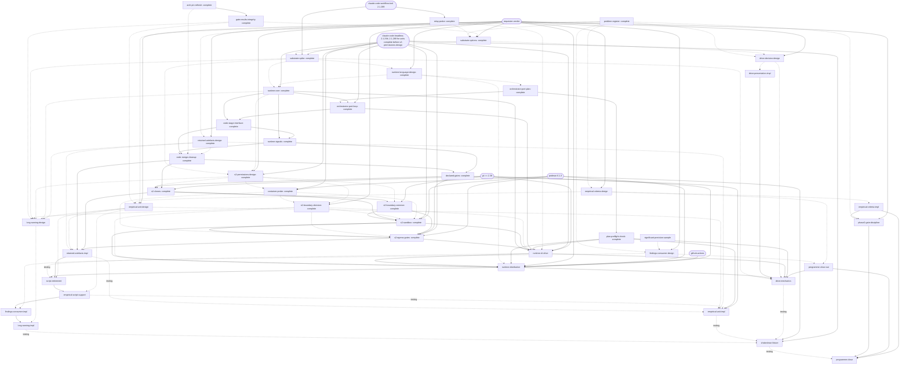

# Breakdown: LSF improvements

## Summary

A programme to investigate and act on the friction recorded in the [archipeligo postmortem](../design/lsf-postmortem-archipeligo-foundation.md). 44 units, 23 complete; critical path 9 units from the empirical design verdicts through the retained-artefact move and the serialised orchestrator stream. Base commit `b3dac6a`.

The postmortem's problems are taken as accurate for archipeligo. The proposals in [lsf-improvements](../design/lsf-improvements.md) are candidate options, not designs: every decision unit states its problem without a solution, checks whether the problem holds outside archipeligo, and weighs the proposal against alternatives that include doing nothing.

The programme is complete when every row of the problem register has a disposition (fixed, with the commit; declined, with the reason; or deferred to a named successor), the `lsf-runtime` tests pass, and the shakedown fixture runs to `complete`.

The substrate is S2, a host runtime running the orchestrator through headless `claude -p` calls, confirmed by `substrate-spike`. The runtime and the orchestrator are written in Go (`runtime-language-design`, requester verdict 2026-10-06; JavaScript and TypeScript excluded), for Linux only (requester, 2026-10-09); the orchestrator is ported, under `lsf-runtime/`. The Workflow script stays the supported Phase 3 path, under `lsf-substrate.md`'s interim policy, until `script-retirement`.

Key risks: gate commands run code the stages wrote, in rootless podman containers behind an egress allow-list proxy whose hardening is incomplete, and Bash can spend on the API through the credential proxy (accepted residual); the S2 build is a conjectured estimate; six units wait on a requester verdict, so requester attention, not agent time, bounds the schedule; and the evidence for generality is one other project (cartomancer-v2), all code units.

Units marked **provisional** have entries the re-plan rewrites when the design unit they depend on completes. A design that declines to act retires its provisional units, with the reason in the register.

## Work Units

### problem-register — complete at `f10f9d5`; entry at `f3a395a`; report `docs/plans/problem-register-completion.md`

### relay-probe — complete at `ff1a49f`; entry at `83bebd1`; report `docs/investigations/relay-probe-results.md`

### substrate-options — complete at `8d22932`; entry at `5d5842f`; report `docs/design/lsf-substrate.md`

### substrate-spike — complete at `23b38d4`; entry at `e2db84f`; report `docs/investigations/substrate-spike-results.md`

### arch-pin-refresh — complete at `382b5e2`; entry at `0cacac9`; report `docs/plans/arch-pin-refresh-completion.md`

### gate-results-integrity — complete at `efc7658`; entry at `c901531`; report `docs/plans/gate-results-integrity-completion.md`

### runtime-language-design — complete at `c3330d2`; entry at `ed6f273`; report `docs/design/lsf-runtime.md` (Language)

### runtime-core — complete at `3b85e99`; entry at `b537a01`; report `docs/plans/runtime-core-completion.md`

### orchestrator-port-plan — complete at `7d1c664`; entry at `d88f63b`; report `docs/plans/orchestrator-port-plan-completion.md`

### orchestrator-port-loop — complete at `799858c`; entry at `cfaf279`; report `docs/plans/orchestrator-port-loop-completion.md`

### code-stage-interface — complete at `65f3efc`; entry at `492b524`; report `docs/plans/code-stage-interface-completion.md`

### retained-artefacts-design — complete at `75e066d`; entry at `b7f5332`; report `docs/design/lsf-empirical-work.md` (Retained artefacts)

### runtime-signals — complete at `c0af1b5`; entry at `85dced0`; report `docs/plans/runtime-signals-completion.md`

### code-merge-cleanup — complete at `5fda684`; entry at `196ddb3`; report `docs/plans/code-merge-cleanup-completion.md`

### declared-gates — complete at `24669e9`; entry at `98e2d66`; report `docs/plans/declared-gates-completion.md`

### plan-preflight-check — complete at `eaa39a2`; entry at `2c98baf`; report `docs/plans/plan-preflight-check-completion.md`

### s2-permissions-design — complete at `d26f71c`; entry at `3c92191`; report `docs/design/lsf-runtime.md` (Permissions)

### s2-clones — complete at `0dc68c0`; entry at `e327632`; report `docs/plans/s2-clones-completion.md`

### s2-boundary-common — complete at `add1164`; entry at `e19f366`; report `docs/plans/s2-boundary-common-completion.md`

### container-probe — complete at `a8d6a54`; entry at `9cee83b`; report `docs/investigations/container-probe-results.md`

### s2-boundary-decision — complete at `c4fe2c1`; entry at `9cee83b`; report `docs/design/lsf-runtime.md` (Permissions)

### s2-sandbox — complete at `9f29b64`; entry at `3e7b8bb`; report `docs/plans/s2-sandbox-completion.md`

### s2-egress-gates — complete at `820c31b`; entry at `f6f0aef`; report `docs/plans/s2-egress-gates-completion.md`

### significant-precision-sample
- **Type**: design
- **Risk**: medium — a hand classification; the rubric decides the answer
- **Clarity**: specified
- **Iteration**: write-once
- **Effort**: medium
- **Scope**: `docs/investigations/lsf-significant-precision.md`
- **Publishes**: a precision estimate for sub-Critical findings, by source stage and project
- **Depends on**: none
- **External gates**: `archipeligo-records` (data, `~/src/archipeligo-evolved` @ `c220c62`, 21 ledgers); `cartomancer-records` (data, `quality-bar-interiors-signals.md`, 1.3 MB)
- **Done condition**: The record is committed with the sampling frame, sample size and classification rubric fixed before any row is classified and stated as such; ledger rows deduplicated into findings; and a precision estimate with an interval per source stage (plan critique, code critique, lens review) for each project. `phronithm:critique` passes at the gate bar.
- **Description**: Postmortem §B and its data gap: Significant-finding precision is unmeasured. Run with `phronithm:investigate`. Without it, any consumer for these findings is chosen blind.

### empirical-criteria-design
- **Type**: design
- **Risk**: high — changes what Phases 1–2 demand of every programme
- **Clarity**: exploratory
- **Iteration**: write-once
- **Effort**: medium
- **Scope**: `docs/design/lsf-empirical-work.md::criteria`
- **Publishes**: the decided requirements on measured success criteria, cited evidence, and the criterion-against-vision check
- **Depends on**: problem-register (knowledge, problem ids and generality classes)
- **External gates**: `archipeligo-records` (data, `~/src/archipeligo-evolved` @ `c220c62`); `cartomancer-records` (data, `~/src/cartomancer-v2` quality-bar-interiors brief and plans); `requester-verdict` (organisational)
- **Done condition**: The Criteria section is committed. It decides what Phases 1–2 require of a success criterion judged by measurement and of evidence cited for an architecture claim, and how a criterion is checked against the vision it stands for. It is walked against archipeligo's three cases (the 3-seed gate, the 41-seed gate, the undefined "persists") and against cartomancer-v2's `quality-bar-interiors`, stating the burden it adds to a programme with no measured criterion. The requester's verdict is recorded.
- **Description**: Postmortem §A (gate designs, evidence from another system, an undefined criterion, a criterion that did not test the vision) and §G.

### empirical-unit-design
- **Type**: design
- **Risk**: high — `phronithm:breakdown` is used outside lsf, so a change here reaches every plan
- **Clarity**: exploratory
- **Iteration**: write-once
- **Effort**: medium
- **Scope**: `docs/design/lsf-empirical-work.md::units`
- **Publishes**: the decided plan-level shape of empirical work; where `Retains:` and the store are declared
- **Depends on**: problem-register (knowledge, problem ids and generality classes); empirical-criteria-design (design, the criteria form a unit's registration cites); gate-results-integrity (knowledge, an empty gates list stops with `gate-not-run`)
- **External gates**: `archipeligo-records` (data, `~/src/archipeligo-evolved` @ `c220c62`); `requester-verdict` (organisational)
- **Done condition**: The Units section is committed. It decides how a plan represents work whose outcome is a measurement, comparing at least a new unit type, added entry fields, and routing the work to `phronithm:investigate`. It covers fail branches (P-A4), the risk and clarity rating of sampled work (P-A5), companion tuning units (P-A6), sizing under outcome uncertainty (P-A9), and a measurement that supersedes cited evidence without moving a decision (P-A10). It decides what a non-design unit declares as its gate in a project with no gate of its own, for measurement and docs units, since an empty gates list stops with `gate-not-run`; the options include a declared `lsf-gates` block, whose `gates` list may not be empty. It decides where a unit's `Retains:` declaration and a project's store are declared (`lsf-empirical-work.md`, Retained artefacts). It is walked against `stage1-gate` at `arch@dc88280` and `stage2-horizon-confirm`. The requester's verdict is recorded.
- **Description**: Postmortem §A's unit-level bullets: campaigns typed `feature` or `integration`, units sized by context and not by outcome uncertainty, measured values accumulating in the architecture document.

### findings-consumer-design
- **Type**: design
- **Risk**: high — may change the stop rule's convergence and no-volume principles
- **Clarity**: exploratory
- **Iteration**: write-once
- **Effort**: medium
- **Scope**: `docs/design/lsf-findings.md`
- **Publishes**: the decision on whether, and by which stage, sub-Critical findings are consumed
- **Depends on**: significant-precision-sample (knowledge, precision estimate); problem-register (knowledge, problem ids and generality classes)
- **External gates**: `requester-verdict` (organisational)
- **Done condition**: `docs/design/lsf-findings.md` is committed. It decides what happens to a finding below Critical, with "surface its text, add no consumer" among the options, cites the measured precision, and states the effect of the choice on the Critical-only convergence bar and on "no volume or recurrence rules". The requester's verdict is recorded.
- **Description**: Postmortem §B: findings below Critical are recorded and read by no stage; two came true unaddressed and the requester patched the gap by hand twice.

### drive-decision-design
- **Type**: design
- **Risk**: high — changes the session role the design records ("a presenter and relauncher, any model tier")
- **Clarity**: exploratory
- **Iteration**: write-once
- **Effort**: medium
- **Scope**: `docs/design/lsf-session-role.md`
- **Publishes**: the decided session role at a stop
- **Depends on**: problem-register (knowledge, problem ids and generality classes); substrate-options (design, the session's duties differ by substrate)
- **External gates**: `requester-verdict` (organisational)
- **Done condition**: `docs/design/lsf-session-role.md` is committed. It decides what analysis precedes a question to the requester, when a recommendation may be made and what it must state, the model tier, the route from repeated stops to an investigation, and whether gates may be cleared ahead of the stop. It is replayed against postmortem §E's four cases (the 41-seed question, "Keep baseline", the three stage-1 stops, the three pre-clearable gates). Since P-E1, P-E3 to P-E7 and P-E9 also occurred on cartomancer-v2 in sessions driven without `phronithm:lsf-drive`, it states whether the decided role binds only `phronithm:lsf-drive` or any session driving a run. The requester's verdict is recorded.
- **Description**: Postmortem §E "Compressed decisions", "A recommendation without its basis", "Options inside a failing frame" and "Pre-clearable gates".

### retained-artefacts-impl
- **Type**: feature
- **Risk**: high — a fault between the move and the worktree's removal deletes data a unit declared kept, P-C9's loss again
- **Clarity**: exploratory — one open decision: how a move across filesystems copies and verifies before the source goes
- **Iteration**: write-once
- **Effort**: medium
- **Scope**: `lsf-runtime/plan`, `lsf-runtime/orchestrator`, `lsf-runtime/runtime`, `docs/design/lsf-runtime.md::runtime`, `docs/design/lsf-workflow.md::wave-loop`
- **Publishes**: the `Retains:` declaration's parse and store check; the journaled move to `<store>/<unit>/`
- **Depends on**: retained-artefacts-design (design, the policy); empirical-unit-design (design, where `Retains:` and the store are declared); code-merge-cleanup (logical, cleanup as a code stage); s2-clones (logical, kept clones and their removal at cleanup); s2-egress-gates (logical, serialises the runtime files)
- **External gates**: `lsf-toolchain` (environment, Go 1.27.1, pinned in `lsf-runtime/go.mod`)
- **Done condition**: A unit's `Retains:` paths are read where `empirical-unit-design` places them, and a `Retains:` line in a project with no declared store fails the load, and so the pre-flight command. At cleanup, a merged unit's kept clones' `Retains:` paths are moved to `<store>/<unit>/`, `<unit>` being the plan's unit id, before the clone is removed; every other ignored or untracked file goes with it, listed in the report. The move is a journaled runtime step: a test kills it mid-move and the resume completes it without stopping on its own partial destination or losing a path, and a destination that exists before the move stops it with the clone kept. A test moves across filesystems and shows the source is removed only after the copy verifies by the method the unit decides. `code-merge-cleanup`'s cleanup tests pass. The tests pass.
- **Description**: The runtime half of `lsf-empirical-work.md`'s Retained artefacts. The parse and the move land together, so no interim rule keeps a worktree for an unmoved declaration. Cleanup's removal is `lsfrt.Runtime.RemoveWorktree` (name kept by `s2-clones`), which removes a label's kept clone `clone/<key>` or a code step's worktree `wt/<key>`, keeps one with commits not fetched, deletes everything untracked or ignored and lists it, and every branch of a merged unit is deleted with it; the move runs before that call, per clone label. `lsf-empirical-work.md` states the policy for worktrees; a kept clone takes the worktree's place one for one (requester verdict, 2026-10-08). The runtime moves on the host; an agent's container mounts no path outside its clone. **Flag:** three code surfaces exceed the surface bound; the `plan` change is one field and its load check, so the excess is not context.

### runtime-cli-drive
- **Type**: integration
- **Risk**: medium
- **Clarity**: exploratory — one open decision: how pause and status are exposed (pause ref, kill file, state file)
- **Iteration**: write-once
- **Effort**: medium
- **Scope**: `lsf-runtime/cli`, `skills/lsf-drive/SKILL.md::launch`, `skills/lsf-drive/SKILL.md::relaunch`, `skills/lsf-drive/SKILL.md::startup`, `docs/design/lsf-runtime.md::cli`
- **Publishes**: the runtime CLI (launch, status, pause, resume, watch)
- **Depends on**: s2-sandbox (logical, the container launch, its configuration and launch checks); s2-egress-gates (logical, the egress proxy a launch holds and the bounded gates); s2-boundary-decision (design, the decided boundary); plan-preflight-check (logical, serialises `skills/lsf-drive/SKILL.md::startup`); relay-probe (knowledge, relay behaviour); runtime-core (logical, `Run` and the state-dir layout: `status.json`, `summary.json`, `lock`); orchestrator-port-loop (logical, `orchestrator.Body`; knowledge, `tools/fixturerun`'s launch sequence)
- **External gates**: `claude-code-headless` (environment, Claude Code 2.1.294); `lsf-toolchain` (environment, Go 1.27.1, pinned in `lsf-runtime/go.mod`); `git` (environment, 2.38 or later; 2.54.0 probed)
- **Done condition**: `phronithm:lsf-drive` launches, pauses, resumes and reads the status of a run through the CLI, under the decided permission configuration. A fixture run launched from a turn in which the requester typed a message shows no agent transcript carrying a relayed message, cited by transcript (P-F1). The driver outlives the interactive session that launched it, or the skill says it runs from the requester's terminal. The Relaunch section keeps `gate-not-run`'s route: an environment or project change, not a decision, whether a stage or the runtime's own gate run raised it. It keeps the `declared-gates-changed` row as `s2-boundary-common` rewrote it: the old and new blocks shown, a relaunch at the escalation's plan SHA only on the requester's explicit approval, otherwise a commit restoring the block and a relaunch at its SHA; no decision changes the block. It gives the route for a code-stage integrity stop, which repeats at every launch until a requester repair commit lands: the repair commit, and exempting the code stages' paths from any hook that rewrites or stages files. Its stop-kind table lists `auth-failed`, answered by renewing the credential and relaunching, `uncommitted-at-return`, `skill-not-loaded`, `schema-violation`, `gate-omitted`, `stage-fault` and `branch-mismatch` with the routes `lsf-workflow.md`'s Relaunch target gives; `uncommitted-at-return` is answered by committing or removing the named paths, not by a decision, and the section says a requester edit in the main checkout stops the run at the next fast-forward. It names the merge faults the requester clears by hand, as the runtime raises them after `s2-clones` moved the merge into a merge clone, each by the remedy its statement gives: a recorded merge SHA that no longer resolves after a history rewrite, a stale `index.lock`, a foreign merge in progress in the main checkout, paths a hook staged after a merge, a `pre-merge-commit` hook included, and a red gate result that the environment caused, which replays from the journal until `journal/gates_<tree prefix>-*.json` is removed (requester decision, 2026-10-08). It names the clone faults the requester clears by hand, each by the remedy its fault text gives: a writer clone or merge clone a fault left, a merge clone whose integration branch diverged from main's, a kept clone left on another branch, a fetch-back failed by a branch the agent renamed, and a fetch-back refused because the branch's tree holds a gitlink (a nested repository the agent committed; requester decision, 2026-10-10: stays `runtime-error`, cleared by hand). Status reports the state dir's `clone/`, `scratch/`, `merge/` and `*.partial` directories, a `refs/lsf/<plan8>/xfer/w<n>` ref present in the main repo, and containers carrying the state dir's label. The CLI's configuration carries the container configuration `s2-sandbox` adds (`image` by digest, `claudeBin`, `claudeVersion`, `podmanBin`, `pluginDir`, `proxy`, `env` passthrough), and the runtime's refusal of an older configuration (one carrying `allow`, `deny` or `permissionMode`) or a launch-check refusal, a dry run's included, reaches the requester with its message. The CLI fills `claudeBin` once per launch (configuration, `LSF_CLAUDE_BIN` or `PATH`), resolved to its versioned path, with `claudeVersion` to match; a test shows a binary replaced mid-launch is not used (requester decision, 2026-10-06). The configuration's documentation says `setup` and gate commands see only the image's environment and the `env` passthrough, so a private registry's credential is passed by name through `env`, and that their toolchain must be in the image. A launch refuses a `git` older than 2.38, naming the version found (requester decision, 2026-10-07). The tests pass.
- **Description**: Replaces `relay-mitigation`: headless calls carry no relay (results, check 3), so P-F1 reduces to the launch path. `tools/fixturerun` is a working launch: configuration from a file, args, `DISABLE_AUTOUPDATER=1` with a versioned `claude` checked before spending, a fresh state dir, then `lsfrt.Run(ctx, cfg, orchestrator.Body)`. A code-stage stop arrives as `stage-fault` with the statement `"<stage> failed: <reason>"`. Under 2.1.294 a 401 is retried ten times, about 3 minutes, before `auth-failed`. Since `s2-sandbox`, a launch, a dry run included, needs rootless podman and the image (smoke container), refuses to start if reaping fails, and the runtime checks `claudeVersion` against the smoke container's `claude --version`. **Flag:** three surfaces exceed the surface bound; the skill and design changes are sections of text, so the excess is not context.

### runtime-distribution
- **Type**: integration
- **Risk**: medium — decides how plugin users get the runtime; D4 changes how the whole plugin ships
- **Clarity**: exploratory — one open decision: D1 (first-use download of a release binary) or D4 (a CI-built `archive` marketplace source)
- **Iteration**: write-once
- **Effort**: medium
- **Scope**: `lsf-runtime/dist`, `.github/workflows/lsf-runtime.yml`, `skills/lsf-drive/SKILL.md::launch`, `skills/lsf-drive/SKILL.md::startup`, `skills/breakdown/SKILL.md::quality-check`, `docs/design/lsf-runtime.md::distribution`
- **Publishes**: the launcher the skills invoke; the release build
- **Depends on**: runtime-cli-drive (logical, the CLI the launcher runs; serialises `skills/lsf-drive/SKILL.md::launch` and `::startup`); runtime-language-design (design, the routes); s2-boundary-decision (design, the boundary's prerequisites); s2-sandbox (logical, the reference `Containerfile` and the launch checks); plan-preflight-check (logical, `lsf-validate`; serialises `skills/breakdown/SKILL.md::quality-check`)
- **External gates**: `github-actions` (environment); `lsf-toolchain` (environment, Go 1.27.1, pinned in `lsf-runtime/go.mod`); `git` (environment, 2.38 or later on every CI runner); `podman` (environment, 6.1.3 rootless, on the CI runner if the container tests run there); `requester-verdict` (organisational)
- **Done condition**: The Distribution section is committed, choosing D1 or D4, with the requester's verdict recorded. CI builds static binaries for linux on amd64 and arm64 with `CGO_ENABLED=0`, and runs the `lsf-runtime` tests on Linux, orphan reaping included. A launcher at `${CLAUDE_PLUGIN_ROOT}/lsf-runtime/` runs the platform's binary, and the plan-validation command through it. `phronithm:breakdown`'s quality check and `phronithm:lsf-drive`'s Startup run `lsf-validate` through the launcher, not `go run`, and tell problems from a command failure by its exit code (1 or 2), not by empty stdout. It prefers a locally built binary or one named by an environment variable, so `--plugin-dir` development and `shakedown-fixture` run the working tree. Under D1 it refuses a binary whose sha256 does not match its pin. The Distribution section names rootless podman with `pasta` as prerequisites, and says how a user builds an image from the reference `Containerfile` with the project's toolchain and records its digest in the runtime config. CI runs the container tests, or the section names those that skip without podman. `phronithm:lsf-drive` invokes the runtime through the launcher; there is no top-level `bin/`. A plugin installed from a local marketplace runs the runtime on this host through the launcher. The tests pass.
- **Description**: `lsf-runtime.md` Language, Open for the re-plan: no unit owned the route, the CI or the release, though the spike's estimate counted packaging. Linux only: Windows outside WSL (requester verdict, 2026-10-06; R16) and macOS (requester, 2026-10-09) are out of scope. Until this unit, both skills call `go -C ${CLAUDE_PLUGIN_ROOT}/lsf-runtime run ./validate/cmd/lsf-validate`, which needs Go and reports every non-zero exit as 1. **Flag:** four surfaces exceed the surface bound; the skill and design changes are a few lines of text each, so the excess is not context.

### script-retirement
- **Type**: refactor
- **Risk**: medium — the declaration rule, if adopted, reaches every plan
- **Clarity**: exploratory — one open decision: whether a plan must declare its gates once the script is gone (requester decision, 2026-10-08)
- **Iteration**: write-once
- **Effort**: medium
- **Scope**: `workflows/`, `lsf-runtime/tools`, `lsf-runtime/orchestrator`, `lsf-runtime/plan/graph.go`, `lsf-runtime/plan/gates.go`, `docs/plan-graph.md::gate-block`, `skills/breakdown/SKILL.md::phase-1`, `docs/design/lsf-workflow.md::constraints`, `docs/design/lsf-workflow.md::lifecycle-mapping`, `docs/design/lsf-workflow.md::wave-loop`, `docs/design/lsf-workflow.md::escalation`, `docs/design/lsf-workflow.md::persistence`, `docs/design/lsf-workflow.md::testing`, `CLAUDE.md`
- **Publishes**: none
- **Depends on**: runtime-cli-drive (testing, the replacement path runs through `phronithm:lsf-drive`); runtime-distribution (logical, plugin users get the runtime before the script is deleted); retained-artefacts-impl (logical, serialises the orchestrator and plan files; the runtime is the only path only once a `Retains:` line is honoured); empirical-unit-design (design, the gate a project with no gate of its own declares)
- **External gates**: none
- **Done condition**: `workflows/` is deleted: the generated script, the JavaScript orchestrator and its tests, `build.js` and the spike. The JavaScript parity tools under `lsf-runtime/tools` (`graphparity`, `promptparity`) are deleted with it, and `go test` has no `node` dependency; the pinned plan fixtures and the divergence registers in `plan/doc.go` and `orchestrator/doc.go` stay. No `// js:` title in the orchestrator tests cites the deleted `implement.test.js` as if it existed: each is deleted, or amended to cite it at a named commit. `lsf-workflow.md` describes the runtime's stages, not the Workflow script's, in per-call clones and a merge clone as `lsf-runtime.md`'s Permissions places them, not worktrees: no copy, scribe or cleanup agent, load-stage agent, or model-call merge (the Go merge's conflict call stays) remains in the Constraints, Lifecycle mapping, Wave loop, Escalation, Persistence or Testing sections. No Go comment describes a stage the Go runs as code as an agent or copy stage (`plan/graph.go`, `orchestrator/report.go`, `prompts.go`, `orchtest/fixtures.go`, as of `code-stage-interface`), and `orchtest`'s `Stub.Call` has no branch for the JavaScript merge prompt. `CLAUDE.md`'s Structure section names `lsf-runtime/` and no longer `workflows/`. The unit decides whether a plan must declare its gates, consistent with `empirical-unit-design`'s gate for a project with none, and records it in `lsf-workflow.md::lifecycle-mapping` with the disposition of R11 and R12 for undeclared plans. If a plan must declare, the load rejects one with no `lsf-gates` block, and `docs/plan-graph.md` and `phronithm:breakdown`'s Phase 1 step 4 say so; otherwise stage-reported gates, `gate-omitted` and the long-gate recipe stay for undeclared plans and are described as the runtime's. The `lsf-runtime` tests pass.
- **Description**: Ends `lsf-substrate.md`'s interim policy: the Workflow script is the supported Phase 3 path until this unit, and the design document describes it until then. **Flag:** five surfaces exceed the surface bound; four are deletions or comment edits, so the context load is the design document's rewrite; the declaration rule, if adopted, is a load check and two sentences.

### empirical-script-support
- **Type**: feature
- **Risk**: medium — provisional on `empirical-unit-design`
- **Clarity**: exploratory
- **Iteration**: write-once
- **Effort**: medium
- **Scope**: `lsf-runtime/plan`, `lsf-runtime/orchestrator`, `docs/design/lsf-workflow.md::wave-loop`
- **Publishes**: the plan-block fields and gate behaviour the empirical design decided
- **Depends on**: empirical-unit-design (design, plan-level shape); script-retirement (logical, serialises the orchestrator files)
- **External gates**: `lsf-toolchain` (environment, Go 1.27.1, pinned in `lsf-runtime/go.mod`)
- **Done condition**: Tests show the parser accepts every plan-block field the empirical design adds other than `Retains:`, which `retained-artefacts-impl` parses, that a measurement superseding a cited figure with no decision moved is handled as the design decided, and that a non-design unit in a project with no gate of its own reaches review with the gate the design decided. The tests pass.
- **Description**: **Provisional.** Retired if the design routes empirical work outside the plan block and leaves the gate unchanged.

### findings-consumer-impl
- **Type**: feature
- **Risk**: medium — provisional on `findings-consumer-design`
- **Clarity**: exploratory
- **Iteration**: write-once
- **Effort**: medium
- **Scope**: `lsf-runtime/plan`, `lsf-runtime/orchestrator`, `docs/design/lsf-workflow.md::escalation`
- **Publishes**: finding identity across review rounds
- **Depends on**: findings-consumer-design (design, the decided consumer); empirical-script-support (logical, serialises the script files)
- **External gates**: `lsf-toolchain` (environment, Go 1.27.1, pinned in `lsf-runtime/go.mod`)
- **Done condition**: Tests show each unfixed Significant finding reaches the decided destination once, however many review rounds repeat it, with its text and referent. The tests pass.
- **Description**: **Provisional.** Postmortem §B.

### long-running-design
- **Type**: design
- **Risk**: high — the wave barrier, re-plan and resume all assume a unit ends with its stage
- **Clarity**: exploratory
- **Iteration**: write-once
- **Effort**: large
- **Scope**: `docs/design/lsf-long-running.md`
- **Publishes**: the decision on work that outlasts a stage
- **Depends on**: substrate-spike (design, confirmed substrate); runtime-core (knowledge, the runtime's supervision of its calls); s2-permissions-design (design, per-call clones); s2-boundary-decision (design, the decided boundary); empirical-unit-design (design, plan-level shape); retained-artefacts-design (design, retained-artefact policy for a job's outputs); gate-results-integrity (knowledge, the `gate-not-run` stop and the long-gate recipe)
- **External gates**: none
- **Done condition**: `docs/design/lsf-long-running.md` is committed. It decides how work that outlasts one agent stage runs under the host runtime, and states the behaviour of the wave barrier, a re-plan while the work is in flight, resume, liveness, and a process left behind by a stopped run. On resume it distinguishes an interrupted attempt from one a re-plan or decision superseded, and states what happens to the interrupted attempt's commits and untracked outputs. It states the behaviour for a descendant that holds a call's stdout after the call exits (not group-killed; the call returns `killGrace` late) and for a retry after partial work. A call's container is removed when the call ends (`--rm`, `--init`, `podman rm -f` at teardown), so no process outlives its call inside it: the design states where a job that outlasts a stage runs (its own container, as a gate command does, or another route), that it reaches only the gate block's `hosts`, and how its outputs survive the clone, which stays until its unit's cleanup. It states the route for a project gate that cannot finish within one stage even with the long-gate recipe, which in a plan with no `lsf-gates` block stops with `gate-not-run` and has no exit through the workflow. For a declared plan, it states how gate runs count against `maxWallClock`: every gate checkout is a cold build in a plain clone fetching the commit's whole history, every merge but a wave's first reruns the gates, units gate one after another under `gateConcurrency` 1, a broken environment costs each waiting unit its full timeout, and a stop kills an in-flight gate, which reruns on relaunch (requester decision, 2026-10-08). It states how a job's outputs fall under the retained-artefact classes: cited by recipe if regenerable, otherwise declared by `Retains:` and moved to the store. `phronithm:critique` (critique-design) passes at the gate bar.
- **Description**: Postmortem §A: 18 campaign stages took 39.7 of 62.1 implement agent-hours; one campaign outlived its stage and left an orphan process.

### long-running-impl
- **Type**: feature
- **Risk**: high — provisional on `long-running-design`
- **Clarity**: exploratory
- **Iteration**: iterative (structural)
- **Effort**: large
- **Scope**: `lsf-runtime/plan`, `lsf-runtime/orchestrator`, `lsf-runtime/runtime`, `docs/design/lsf-workflow.md::wave-loop`, `docs/design/lsf-workflow.md::lifecycle-mapping`
- **Publishes**: none
- **Depends on**: long-running-design (design, the decision); findings-consumer-impl (logical, serialises the orchestrator files)
- **External gates**: `lsf-toolchain` (environment, Go 1.27.1, pinned in `lsf-runtime/go.mod`)
- **Done condition**: A test shows a unit whose job outlasts its launching stage completes with its results reviewed, and that a stopped run leaves no process the run has no record of. A test shows that resuming a run treats an interrupted implement attempt's commits and untracked outputs as `long-running-design` decided (P-D6), and that a project gate outlasting its stage in a plan with no `lsf-gates` block takes the route it decided. The tests pass.
- **Description**: **Provisional.** The re-plan after `long-running-design` splits this unit if the decision spans more than the orchestrator and runtime.

### empirical-criteria-impl
- **Type**: feature
- **Risk**: low
- **Clarity**: specified
- **Iteration**: write-once
- **Effort**: small
- **Scope**: `skills/large-scale-feature/SKILL.md::phase-1`, `skills/large-scale-feature/SKILL.md::phase-2`
- **Publishes**: none
- **Depends on**: empirical-criteria-design (design, decided requirements)
- **External gates**: none
- **Done condition**: `skills/large-scale-feature/SKILL.md` Phases 1–2 carry the decided requirements. `phronithm:critique` (critique-skill) passes at the gate bar and a `phronithm:edit` pass has been applied.
- **Description**: **Provisional.**

### phase2-gate-discipline
- **Type**: feature
- **Risk**: medium — the adversary's measured recall at sonnet is 0/14; the opus re-run `critique-gate.md` waits on is outside this plan
- **Clarity**: exploratory — one open decision: what lsf says about an adversarial pass before that re-run exists
- **Iteration**: write-once
- **Effort**: small
- **Scope**: `skills/large-scale-feature/SKILL.md::phase-2`, `docs/critique-gate.md`
- **Publishes**: none
- **Depends on**: problem-register (knowledge, problem ids and generality classes); empirical-criteria-impl (logical, serialises the Phase 2 section)
- **External gates**: `requester-verdict` (organisational)
- **Done condition**: Phase 2 and its re-entry sub-procedure state the decided policy on an adversarial pass, consistent with `critique-gate.md`'s reinstatement condition, and state when a review instrument produced in Phase 1 is run. `phronithm:critique` (critique-skill) passes at the gate bar. The requester's verdict on the adversary policy is recorded.
- **Description**: Postmortem §G: the one re-entry gated by a sonnet critic alone passed a design reversed about 25 h later; a Phase 1 instrument first ran as Phase 3's first unit and forced four amendment rounds.

### empirical-unit-impl
- **Type**: feature
- **Risk**: medium — provisional on `empirical-unit-design`
- **Clarity**: specified
- **Iteration**: write-once
- **Effort**: medium
- **Scope**: `skills/breakdown/SKILL.md`, `docs/plan-graph.md`
- **Publishes**: none
- **Depends on**: empirical-unit-design (design, plan-level shape); retained-artefacts-design (design, retained-artefact policy); empirical-script-support, retained-artefacts-impl (testing, the parser must accept what the skill emits, `Retains:` included); plan-preflight-check, declared-gates (logical, each serialises a section of `skills/breakdown/SKILL.md`; declared-gates also `docs/plan-graph.md`)
- **External gates**: none
- **Done condition**: `skills/breakdown/SKILL.md` and `docs/plan-graph.md` carry the decided shape and the retained-artefact policy: a record cites regenerable data by recipe, the regenerable and non-regenerable classes with the burden of proof on regenerability, the recipe's contents, and the `Retains:` and store declarations. The citation rule is stated as scoped to programmes whose records cite measured data. A fixture plan written to it passes the pre-flight command. `phronithm:critique` (critique-skill) passes at the gate bar and a `phronithm:edit` pass has been applied.
- **Description**: **Provisional.**

### programme-close-out
- **Type**: feature
- **Risk**: medium
- **Clarity**: exploratory — one open decision: what a programme-level close consists of
- **Iteration**: write-once
- **Effort**: medium
- **Scope**: `skills/large-scale-feature/SKILL.md::termination`, `skills/lsf-drive/SKILL.md::termination`
- **Publishes**: none
- **Depends on**: findings-consumer-design (design, what an unfixed finding is at close); empirical-criteria-design (design, the criterion-against-vision check)
- **External gates**: `archipeligo-records` (data, `~/src/archipeligo-evolved` @ `c220c62`)
- **Done condition**: Both Termination sections define a programme-level close: a review of what was delivered against the request record and the vision, and an audit of unfixed findings over every unit. Walked against archipeligo's close-out, the step as written covers the 26 review-stage rows that audit missed and prompts the vision review the requester had to ask for. `phronithm:critique` (critique-skill) passes at the gate bar.
- **Description**: Postmortem §B's last two paragraphs.

### drive-presentation-impl
- **Type**: feature
- **Risk**: medium — provisional on `drive-decision-design`
- **Clarity**: specified
- **Iteration**: write-once
- **Effort**: medium
- **Scope**: `skills/lsf-drive/SKILL.md::present`, `skills/lsf-drive/SKILL.md::decide`, `docs/design/lsf-workflow.md::architecture`
- **Publishes**: none
- **Depends on**: drive-decision-design (design, decided session role)
- **External gates**: none
- **Done condition**: `phronithm:lsf-drive`'s Present and Decide sections and the design's Session paragraph agree with `docs/design/lsf-session-role.md`. `phronithm:critique` (critique-skill) passes at the gate bar and a `phronithm:edit` pass has been applied.
- **Description**: **Provisional.**

### drive-mechanics
- **Type**: feature
- **Risk**: medium — several small rules in an 18 KB skill; the over-budget step count is flagged below
- **Clarity**: exploratory — the driving duties depend on the substrate
- **Iteration**: write-once
- **Effort**: medium
- **Scope**: `skills/lsf-drive/SKILL.md`
- **Publishes**: none
- **Depends on**: substrate-spike (design, confirmed substrate); drive-decision-design (design, whether driving rules bind only `phronithm:lsf-drive`); drive-presentation-impl, runtime-cli-drive, runtime-distribution, plan-preflight-check, programme-close-out (logical, each serialises a section of `skills/lsf-drive/SKILL.md`)
- **External gates**: none
- **Done condition**: For each of P-E1, P-E6, P-E7, P-E8, P-E9 and P-I1, `phronithm:lsf-drive` carries a rule or the unit's completion report gives the register row a `declined` disposition with the reason. The Relaunch section keeps `gate-not-run`'s route. The skill's byte size before and after is reported. `phronithm:critique` (critique-skill) passes at the gate bar and a `phronithm:edit` pass has been applied.
- **Description**: About 60% of requester inputs in the first week were mechanics. The unit first asks which duties the runtime CLI removes, and adds rules only for those that remain. **Flag:** up to seven items exceeds the planned-steps bound; each is a few lines of skill text in one file, so the excess is not context.

### shakedown-fixture
- **Type**: integration
- **Risk**: medium — a live run; depends on every script unit
- **Clarity**: exploratory — one open decision: where the fixture lives (this repository or `~/src/critic-fidelity-bench`)
- **Iteration**: iterative (structural)
- **Effort**: medium
- **Scope**: `lsf-runtime/fixtures/shakedown`, `docs/design/lsf-workflow.md::status`, `docs/design/lsf-workflow.md::testing`
- **Publishes**: a fixture plan covering the unit kinds the runtime claims to run
- **Depends on**: long-running-impl (testing, the last script unit); empirical-unit-impl (testing, the plan form); drive-mechanics (testing, the launch path)
- **External gates**: `claude-code-headless` (environment, Claude Code 2.1.294); `podman` (environment, 6.1.3 rootless, `pasta` 2026_10_02.cba3570)
- **Done condition**: The runtime, launched through `phronithm:lsf-drive` in containers from an image built from the reference `Containerfile` extended with the fixture's gate toolchain, its digest recorded, on a fixture plan with at least one code unit whose gate runs past the 600 s tool timeout, one design unit that settles a decision the architecture document left open, and one empirical unit whose job outlasts the tool timeout, returns `complete`, with the design unit's change recorded as an architecture amendment. A second run, on a variant whose unit moves a decision the document made, stops with `architecture-invalidated`. The design's Status section cites both run ids, lists the unit kinds the runtime has run on, and records how the long gate completed.
- **Description**: Postmortem §G: the workflow was shaken down on code units and met measurement units first on a live programme. The two architecture cases are the upgrade path for the gate half of `arch-pin-refresh`'s done condition, and the long gate for `gate-results-integrity`'s live long-gate claim; both were `conjectured` at completion. `tools/fixturerun` is a starting point for the launch; its caps (40 calls, $25, 1 h) suit one unit. **Flag:** the scope path moves if the fixture lives in the bench repository.

### programme-close
- **Type**: integration
- **Risk**: low
- **Clarity**: specified
- **Iteration**: write-once
- **Effort**: small
- **Scope**: `docs/design/lsf-problem-register.md`, `docs/design/lsf-improvements.md`, `docs/design/lsf-workflow.md::status`, `CLAUDE.md`
- **Publishes**: none
- **Depends on**: shakedown-fixture (testing, the run); phase2-gate-discipline, programme-close-out, empirical-criteria-impl (logical, their dispositions)
- **External gates**: none
- **Done condition**: Every register row has a disposition: `fixed` with a commit, `declined` with a reason, or `deferred` to a named successor. `docs/design/lsf-improvements.md` is deleted. `CLAUDE.md`'s Structure section lists the documents and commands the programme added. The `lsf-runtime` tests pass.
- **Description**: The closure unit: it owns the completeness criterion the other units contribute to (Standing Obligations).

## Graph

```yaml lsf-plan
units:
  - id: problem-register
    type: foundation
    complete: true
    dependencies: []
    scope: [docs/design/lsf-problem-register.md]
    publishes: [problem ids, generality classes, topic tags]
    gates:
      - name: archipeligo-records
        kind: data
        pin: "archipeligo-evolved c220c62"
      - name: cartomancer-records
        kind: data
        pin: "quality-bar-interiors-signals.md; transcripts from 2026-09-10"
  - id: relay-probe
    type: design
    complete: true
    dependencies: []
    scope: [docs/design/lsf-workflow.md::constraints]
    publishes: [relay behaviour]
    gates:
      - name: claude-code-workflow-tool
        kind: environment
        pin: "2.1.289"
  - id: substrate-options
    type: design
    complete: true
    dependencies: [problem-register, relay-probe, gate-results-integrity]
    scope: [docs/design/lsf-substrate.md]
    publishes: [selected option, interim script policy]
    gates:
      - name: requester-verdict
        kind: organisational
  - id: substrate-spike
    type: design
    complete: true
    dependencies: [substrate-options]
    scope: [docs/design/lsf-substrate.md, workflows/lsf/spike]
    publishes: [confirmed substrate]
    gates:
      - name: claude-code-workflow-tool
        kind: environment
        pin: "2.1.289"
      - name: claude-code-headless
        kind: environment
        pin: "2.1.289"
      - name: node
        kind: environment
        pin: "v26.9.0"
  - id: arch-pin-refresh
    type: bug-fix
    complete: true
    dependencies: []
    scope: [workflows/lsf/implement.js, workflows/lsf/scheduling.js, workflows/lsf/schema.js, workflows/lsf/test/implement.test.js, workflows/lsf/test/scheduling.test.js, workflows/lsf-implement.js, docs/design/lsf-workflow.md::wave-loop]
    publishes: [merge-stage architectureSha and merges sha, gate amendments]
    gates:
      - name: node
        kind: environment
        pin: "v26.9.0"
  - id: gate-results-integrity
    type: bug-fix
    complete: true
    dependencies: [arch-pin-refresh]
    scope: [workflows/lsf/implement.js, workflows/lsf/schema.js, workflows/lsf/test/implement.test.js, workflows/lsf-implement.js, docs/design/lsf-workflow.md::lifecycle-mapping, skills/lsf-drive/SKILL.md::relaunch]
    publishes: [fix return shape, gate-not-run stop, long-gate recipe, P-D3 residual]
    gates:
      - name: node
        kind: environment
        pin: "v26.9.0"
  - id: plan-preflight-check
    type: feature
    complete: true
    dependencies: [orchestrator-port-plan]
    scope: [lsf-runtime/validate, skills/breakdown/SKILL.md::quality-check, skills/lsf-drive/SKILL.md::startup]
    publishes: [plan-validation command]
    gates:
      - name: lsf-toolchain
        kind: environment
        pin: "1.27.1"
  - id: significant-precision-sample
    type: design
    complete: false
    dependencies: []
    scope: [docs/investigations/lsf-significant-precision.md]
    publishes: [precision estimate]
    gates:
      - name: archipeligo-records
        kind: data
        pin: "archipeligo-evolved c220c62"
      - name: cartomancer-records
        kind: data
        pin: "quality-bar-interiors-signals.md"
  - id: empirical-criteria-design
    type: design
    complete: false
    dependencies: [problem-register]
    scope: [docs/design/lsf-empirical-work.md::criteria]
    publishes: [criteria requirements]
    gates:
      - name: archipeligo-records
        kind: data
        pin: "archipeligo-evolved c220c62"
      - name: cartomancer-records
        kind: data
        pin: "quality-bar-interiors brief and plans"
      - name: requester-verdict
        kind: organisational
  - id: empirical-unit-design
    type: design
    complete: false
    dependencies: [problem-register, empirical-criteria-design, gate-results-integrity]
    scope: [docs/design/lsf-empirical-work.md::units]
    publishes: [empirical work plan shape]
    gates:
      - name: archipeligo-records
        kind: data
        pin: "archipeligo-evolved c220c62"
      - name: requester-verdict
        kind: organisational
  - id: retained-artefacts-design
    type: design
    complete: true
    dependencies: [problem-register]
    scope: [docs/design/lsf-empirical-work.md::retained-artefacts]
    publishes: [retained-artefact policy]
    gates:
      - name: archipeligo-records
        kind: data
        pin: "archipeligo-evolved c220c62"
      - name: archipeligo-runs
        kind: data
        pin: "~/src/archipeligo-runs, 80 GB on 2026-10-04"
      - name: requester-verdict
        kind: organisational
  - id: findings-consumer-design
    type: design
    complete: false
    dependencies: [significant-precision-sample, problem-register]
    scope: [docs/design/lsf-findings.md]
    publishes: [findings consumer decision]
    gates:
      - name: requester-verdict
        kind: organisational
  - id: drive-decision-design
    type: design
    complete: false
    dependencies: [problem-register, substrate-options]
    scope: [docs/design/lsf-session-role.md]
    publishes: [session role]
    gates:
      - name: requester-verdict
        kind: organisational
  - id: s2-permissions-design
    type: design
    complete: true
    dependencies: [substrate-spike, runtime-core]
    scope: [docs/design/lsf-runtime.md::permissions]
    publishes: [per-stage permission configuration]
    gates:
      - name: claude-code-headless
        kind: environment
        pin: "2.1.294"
      - name: requester-verdict
        kind: organisational
  - id: runtime-language-design
    type: design
    complete: true
    dependencies: [substrate-spike]
    scope: [docs/design/lsf-runtime.md::language, docs/investigations/runtime-language-probes, lsf-runtime/go.mod, lsf-runtime/plan/doc.go, lsf-runtime/runtime/doc.go, lsf-runtime/orchestrator/doc.go, lsf-runtime/cli/main.go, lsf-runtime/testdata/claude]
    publishes: [language, toolchain pin and source layout]
    gates:
      - name: requester-verdict
        kind: organisational
  - id: runtime-core
    type: foundation
    complete: true
    dependencies: [substrate-spike, runtime-language-design]
    scope: [lsf-runtime/runtime, lsf-runtime/testdata, docs/design/lsf-runtime.md::runtime, CLAUDE.md]
    publishes: [host runtime, journal, stage roles as configuration, call result, step API, worktree isolation]
    gates:
      - name: lsf-toolchain
        kind: environment
        pin: "1.27.1"
      - name: claude-code-headless
        kind: environment
        pin: "2.1.289"
  - id: orchestrator-port-plan
    type: foundation
    complete: true
    dependencies: [runtime-language-design]
    scope: [lsf-runtime/plan, lsf-runtime/tools, CLAUDE.md]
    publishes: [plan graph, schema and scheduling rules]
    gates:
      - name: lsf-toolchain
        kind: environment
        pin: "1.27.1"
  - id: orchestrator-port-loop
    type: foundation
    complete: true
    dependencies: [orchestrator-port-plan, runtime-core]
    scope: [lsf-runtime/orchestrator, lsf-runtime/tools, lsf-runtime/plan/doc.go, CLAUDE.md::lsf-runtime]
    publishes: [orchestrator run(runtime), orchestrator.Body, orchtest harness, tools/promptparity, tools/fixturerun]
    gates:
      - name: lsf-toolchain
        kind: environment
        pin: "1.27.1"
      - name: claude-code-headless
        kind: environment
        pin: "2.1.289"
  - id: code-stage-interface
    type: refactor
    complete: true
    dependencies: [orchestrator-port-loop, runtime-core]
    scope: [lsf-runtime/orchestrator, lsf-runtime/runtime, lsf-runtime/tools/promptparity, docs/design/lsf-workflow.md::model-tiers, docs/design/lsf-runtime.md::runtime, CLAUDE.md::lsf-runtime]
    publishes: [code-stage interface, CallResult in the orchestrator]
    gates:
      - name: lsf-toolchain
        kind: environment
        pin: "1.27.1"
  - id: code-merge-cleanup
    type: refactor
    complete: true
    dependencies: [code-stage-interface, runtime-signals, arch-pin-refresh, retained-artefacts-design]
    scope: [lsf-runtime/orchestrator, lsf-runtime/runtime, lsf-runtime/plan, lsf-runtime/tools/promptparity, docs/design/lsf-workflow.md::model-tiers, docs/design/lsf-workflow.md::wave-loop, docs/design/lsf-workflow.md::escalation, docs/design/lsf-runtime.md::runtime, CLAUDE.md::lsf-runtime]
    publishes: [merge and cleanup code stages, RemoveWorktree, CallResult Branch, commitFiles, branch-mismatch stop kind, merge-conflict call label]
    gates:
      - name: lsf-toolchain
        kind: environment
        pin: "1.27.1"
  - id: runtime-signals
    type: feature
    complete: true
    dependencies: [code-stage-interface, runtime-core]
    scope: [lsf-runtime/plan, lsf-runtime/runtime, lsf-runtime/orchestrator, lsf-runtime/tools, docs/design/lsf-workflow.md::escalation, docs/design/lsf-workflow.md::lifecycle-mapping, docs/design/lsf-workflow.md::wave-loop, docs/design/lsf-runtime.md::runtime, CLAUDE.md::lsf-runtime]
    publishes: [driver-event signal kinds, SignalsFromCall, CallResult Uncommitted and Violations, ValidateOutput]
    gates:
      - name: lsf-toolchain
        kind: environment
        pin: "1.27.1"
  - id: declared-gates
    type: feature
    complete: true
    dependencies: [code-merge-cleanup, runtime-signals]
    scope: [lsf-runtime/plan, lsf-runtime/runtime, lsf-runtime/orchestrator, docs/plan-graph.md, skills/breakdown/SKILL.md::interface, skills/breakdown/SKILL.md::phase-1, skills/breakdown/SKILL.md::quality-check, skills/breakdown/SKILL.md::graph, skills/breakdown/SKILL.md::re-plan, skills/lsf-drive/SKILL.md::relaunch, docs/design/lsf-workflow.md::lifecycle-mapping, docs/design/lsf-workflow.md::wave-loop, docs/design/lsf-workflow.md::escalation, docs/design/lsf-runtime.md::runtime, CLAUDE.md::plan-graph, CLAUDE.md::lsf-runtime]
    publishes: [declared gate-command field, RunGates, GateSpec and GateRun, gateTimeout and gateConcurrency, declared-gates-changed stop kind, gate-misreported record]
    gates:
      - name: lsf-toolchain
        kind: environment
        pin: "1.27.1"
  - id: s2-clones
    type: feature
    complete: true
    dependencies: [s2-permissions-design, code-merge-cleanup, declared-gates]
    scope: [lsf-runtime/runtime, lsf-runtime/orchestrator, lsf-runtime/internal, lsf-runtime/tools, lsf-runtime/testdata, docs/design/lsf-runtime.md::runtime, CLAUDE.md::lsf-runtime, .gitignore]
    publishes: [per-call clones, integration fast-forward step, merge clone, clone role field, MergeClone and RemoveMergeClone, Config PluginDir, CallResult Clone and CloneHead]
    gates:
      - name: lsf-toolchain
        kind: environment
        pin: "1.27.1"
      - name: git
        kind: environment
        pin: ">= 2.38"
  - id: container-probe
    type: design
    complete: true
    dependencies: [s2-permissions-design]
    scope: [docs/investigations/container-probe-results.md, docs/investigations/container-probe]
    publishes: [container probe results]
    gates:
      - name: podman
        kind: environment
        pin: "6.1.3"
      - name: claude-code-headless
        kind: environment
        pin: "2.1.294"
  - id: s2-boundary-decision
    type: design
    complete: true
    dependencies: [container-probe, s2-permissions-design]
    scope: [docs/design/lsf-runtime.md::permissions]
    publishes: [decided boundary and its runtime changes]
    gates:
      - name: requester-verdict
        kind: organisational
  - id: s2-boundary-common
    type: feature
    complete: true
    dependencies: [s2-clones, s2-permissions-design]
    scope: [lsf-runtime/runtime, lsf-runtime/orchestrator, lsf-runtime/plan/gates.go, lsf-runtime/plan/schema.go, lsf-runtime/internal, lsf-runtime/testdata, lsf-runtime/tools, lsf-runtime/validate, docs/plan-graph.md::gate-block, skills/breakdown/SKILL.md::phase-1, skills/lsf-drive/SKILL.md::relaunch, docs/design/lsf-runtime.md::runtime, docs/design/lsf-workflow.md::escalation, CLAUDE.md::lsf-runtime]
    publishes: [credential proxy, Runtime Proxy and Hosts, hosts gate field and launch pin, plain-clone gate checkout, clone git config isolation, auth-failed stop kind]
    gates:
      - name: lsf-toolchain
        kind: environment
        pin: "1.27.1"
      - name: git
        kind: environment
        pin: ">= 2.38"
  - id: s2-sandbox
    type: feature
    complete: true
    dependencies: [s2-boundary-decision, s2-boundary-common, s2-clones, container-probe]
    scope: [lsf-runtime/runtime, lsf-runtime/internal, lsf-runtime/orchestrator, lsf-runtime/testdata, lsf-runtime/tools/fixturerun, lsf-runtime/container, docs/design/lsf-runtime.md::runtime, docs/design/lsf-runtime.md::permissions, CLAUDE.md::lsf-runtime]
    publishes: [container call launch, container configuration and launch checks, teardown and reaping by name and label, reference Containerfile, gitenv clone guards, StateLabel, stub podman]
    gates:
      - name: lsf-toolchain
        kind: environment
        pin: "1.27.1"
      - name: claude-code-headless
        kind: environment
        pin: "2.1.294"
      - name: podman
        kind: environment
        pin: "6.1.3"
  - id: s2-egress-gates
    type: feature
    complete: true
    dependencies: [s2-sandbox, s2-boundary-common, declared-gates, s2-boundary-decision, container-probe]
    scope: [lsf-runtime/runtime, lsf-runtime/testdata, docs/design/lsf-runtime.md::runtime, docs/design/lsf-runtime.md::permissions, CLAUDE.md::lsf-runtime]
    publishes: [egress allow-list proxy, bounded gate runs, bare-429 session-limit class]
    gates:
      - name: lsf-toolchain
        kind: environment
        pin: "1.27.1"
      - name: claude-code-headless
        kind: environment
        pin: "2.1.294"
      - name: podman
        kind: environment
        pin: "6.1.3"
  - id: retained-artefacts-impl
    type: feature
    complete: false
    dependencies: [retained-artefacts-design, empirical-unit-design, code-merge-cleanup, s2-clones, s2-egress-gates]
    scope: [lsf-runtime/plan, lsf-runtime/orchestrator, lsf-runtime/runtime, docs/design/lsf-runtime.md::runtime, docs/design/lsf-workflow.md::wave-loop]
    publishes: [Retains parse and store check, journaled store move]
    gates:
      - name: lsf-toolchain
        kind: environment
        pin: "1.27.1"
  - id: runtime-cli-drive
    type: integration
    complete: false
    dependencies: [s2-sandbox, s2-egress-gates, s2-boundary-decision, plan-preflight-check, relay-probe, runtime-core, orchestrator-port-loop]
    scope: [lsf-runtime/cli, skills/lsf-drive/SKILL.md::launch, skills/lsf-drive/SKILL.md::relaunch, skills/lsf-drive/SKILL.md::startup, docs/design/lsf-runtime.md::cli]
    publishes: [runtime CLI]
    gates:
      - name: claude-code-headless
        kind: environment
        pin: "2.1.294"
      - name: lsf-toolchain
        kind: environment
        pin: "1.27.1"
      - name: git
        kind: environment
        pin: ">= 2.38"
  - id: runtime-distribution
    type: integration
    complete: false
    dependencies: [runtime-cli-drive, runtime-language-design, s2-boundary-decision, s2-sandbox, plan-preflight-check]
    scope: [lsf-runtime/dist, .github/workflows/lsf-runtime.yml, skills/lsf-drive/SKILL.md::launch, skills/lsf-drive/SKILL.md::startup, skills/breakdown/SKILL.md::quality-check, docs/design/lsf-runtime.md::distribution]
    publishes: [runtime launcher, release build]
    gates:
      - name: github-actions
        kind: environment
      - name: lsf-toolchain
        kind: environment
        pin: "1.27.1"
      - name: git
        kind: environment
        pin: ">= 2.38"
      - name: podman
        kind: environment
        pin: "6.1.3"
      - name: requester-verdict
        kind: organisational
  - id: script-retirement
    type: refactor
    complete: false
    dependencies: [runtime-cli-drive, runtime-distribution, retained-artefacts-impl, empirical-unit-design]
    scope: [workflows, lsf-runtime/tools, lsf-runtime/orchestrator, lsf-runtime/plan/graph.go, lsf-runtime/plan/gates.go, docs/plan-graph.md::gate-block, skills/breakdown/SKILL.md::phase-1, docs/design/lsf-workflow.md::constraints, docs/design/lsf-workflow.md::lifecycle-mapping, docs/design/lsf-workflow.md::wave-loop, docs/design/lsf-workflow.md::escalation, docs/design/lsf-workflow.md::persistence, docs/design/lsf-workflow.md::testing, CLAUDE.md]
    publishes: []
    gates: []
  - id: empirical-script-support
    type: feature
    complete: false
    dependencies: [empirical-unit-design, script-retirement]
    scope: [lsf-runtime/plan, lsf-runtime/orchestrator, docs/design/lsf-workflow.md::wave-loop]
    publishes: [empirical plan-block fields]
    gates:
      - name: lsf-toolchain
        kind: environment
        pin: "1.27.1"
  - id: findings-consumer-impl
    type: feature
    complete: false
    dependencies: [findings-consumer-design, empirical-script-support]
    scope: [lsf-runtime/plan, lsf-runtime/orchestrator, docs/design/lsf-workflow.md::escalation]
    publishes: [finding identity]
    gates:
      - name: lsf-toolchain
        kind: environment
        pin: "1.27.1"
  - id: long-running-design
    type: design
    complete: false
    dependencies: [substrate-spike, runtime-core, s2-permissions-design, s2-boundary-decision, empirical-unit-design, retained-artefacts-design, gate-results-integrity]
    scope: [docs/design/lsf-long-running.md]
    publishes: [long-running work decision]
    gates: []
  - id: long-running-impl
    type: feature
    complete: false
    dependencies: [long-running-design, findings-consumer-impl]
    scope: [lsf-runtime/plan, lsf-runtime/orchestrator, lsf-runtime/runtime, docs/design/lsf-workflow.md::wave-loop, docs/design/lsf-workflow.md::lifecycle-mapping]
    publishes: []
    gates:
      - name: lsf-toolchain
        kind: environment
        pin: "1.27.1"
  - id: empirical-criteria-impl
    type: feature
    complete: false
    dependencies: [empirical-criteria-design]
    scope: [skills/large-scale-feature/SKILL.md::phase-1, skills/large-scale-feature/SKILL.md::phase-2]
    publishes: []
    gates: []
  - id: phase2-gate-discipline
    type: feature
    complete: false
    dependencies: [problem-register, empirical-criteria-impl]
    scope: [skills/large-scale-feature/SKILL.md::phase-2, docs/critique-gate.md]
    publishes: []
    gates:
      - name: requester-verdict
        kind: organisational
  - id: empirical-unit-impl
    type: feature
    complete: false
    dependencies: [empirical-unit-design, retained-artefacts-design, empirical-script-support, retained-artefacts-impl, plan-preflight-check, declared-gates]
    scope: [skills/breakdown/SKILL.md, docs/plan-graph.md]
    publishes: []
    gates: []
  - id: programme-close-out
    type: feature
    complete: false
    dependencies: [findings-consumer-design, empirical-criteria-design]
    scope: [skills/large-scale-feature/SKILL.md::termination, skills/lsf-drive/SKILL.md::termination]
    publishes: []
    gates:
      - name: archipeligo-records
        kind: data
        pin: "archipeligo-evolved c220c62"
  - id: drive-presentation-impl
    type: feature
    complete: false
    dependencies: [drive-decision-design]
    scope: [skills/lsf-drive/SKILL.md::present, skills/lsf-drive/SKILL.md::decide, docs/design/lsf-workflow.md::architecture]
    publishes: []
    gates: []
  - id: drive-mechanics
    type: feature
    complete: false
    dependencies: [substrate-spike, drive-decision-design, drive-presentation-impl, runtime-cli-drive, runtime-distribution, plan-preflight-check, programme-close-out]
    scope: [skills/lsf-drive/SKILL.md]
    publishes: []
    gates: []
  - id: shakedown-fixture
    type: integration
    complete: false
    dependencies: [long-running-impl, empirical-unit-impl, drive-mechanics]
    scope: [lsf-runtime/fixtures/shakedown, docs/design/lsf-workflow.md::status, docs/design/lsf-workflow.md::testing]
    publishes: [shakedown fixture plan]
    gates:
      - name: claude-code-headless
        kind: environment
        pin: "2.1.294"
      - name: podman
        kind: environment
        pin: "6.1.3"
  - id: programme-close
    type: integration
    complete: false
    dependencies: [shakedown-fixture, phase2-gate-discipline, programme-close-out, empirical-criteria-impl]
    scope: [docs/design/lsf-problem-register.md, docs/design/lsf-improvements.md, docs/design/lsf-workflow.md::status, CLAUDE.md]
    publishes: []
    gates: []
execution_order: [problem-register, relay-probe, arch-pin-refresh, gate-results-integrity, substrate-options, significant-precision-sample, empirical-criteria-design, retained-artefacts-design, substrate-spike, empirical-unit-design, findings-consumer-design, drive-decision-design, runtime-language-design, runtime-core, s2-permissions-design, orchestrator-port-plan, plan-preflight-check, orchestrator-port-loop, code-stage-interface, runtime-signals, code-merge-cleanup, declared-gates, s2-clones, container-probe, s2-boundary-common, s2-boundary-decision, s2-sandbox, s2-egress-gates, retained-artefacts-impl, runtime-cli-drive, runtime-distribution, script-retirement, empirical-script-support, findings-consumer-impl, long-running-design, long-running-impl, empirical-criteria-impl, phase2-gate-discipline, empirical-unit-impl, programme-close-out, drive-presentation-impl, drive-mechanics, shakedown-fixture, programme-close]
```

## Dependency Graph

Solid arrows are logical edges (including file serialisation), dashed are testing, dotted are design or knowledge. Gates are drawn as rounded nodes; the `node` and data gates, which are probed and present, and `lsf-toolchain` (Go, pinned in `lsf-runtime/go.mod`), are omitted.



## Execution Order

1. `problem-register`, `relay-probe`. The register is the foundation. The probe is small and feeds the substrate decision.
2. `arch-pin-refresh`, `gate-results-integrity`, `substrate-options`, `significant-precision-sample`. The highest-risk decision is taken as early as its inputs allow. The precision sample has no dependencies and gates the findings decision.
3. `empirical-criteria-design`, `retained-artefacts-design`, `substrate-spike`.
4. `empirical-unit-design`, `findings-consumer-design`, `drive-decision-design`, `runtime-language-design`. Each design decision lands before any unit it governs starts.
5. `runtime-core`, `s2-permissions-design`, `orchestrator-port-plan`, `plan-preflight-check`, `orchestrator-port-loop`. The permissions design states its options in the runtime's role shape. The runtime and the port; the plan model and the runtime can run side by side, and the pre-flight command uses the ported parser.
6. `code-stage-interface`, `runtime-signals`, `code-merge-cleanup`, `declared-gates`, `s2-clones`, `container-probe`, `s2-boundary-common`, `s2-boundary-decision`, `s2-sandbox`, `s2-egress-gates`, `retained-artefacts-impl`, `runtime-cli-drive`, `runtime-distribution`, `script-retirement`. The rest of the S2 build, serial on `lsf-runtime/`. The probe ran before the boundary decision (requester, 2026-10-09); calls move into containers before gates and egress, which reuse their launch and teardown. The permission boundary lands before the CLI, so every launch through `phronithm:lsf-drive` runs under it. It leads the orchestrator stream so later units are built and tested on the runtime, not the Workflow script. `retained-artefacts-impl` runs beside `runtime-cli-drive` and `runtime-distribution`, which write none of its files, and lands before `script-retirement` makes the runtime the only path.
7. `empirical-script-support`, `findings-consumer-impl`. The rest of the orchestrator stream, serial on `lsf-runtime/plan` and `lsf-runtime/orchestrator`.
8. `long-running-design`, `long-running-impl`. Last in the stream: the least certain unit, and the one most likely to be re-planned.
9. `empirical-criteria-impl`, `phase2-gate-discipline`, `empirical-unit-impl`, `programme-close-out`, `drive-presentation-impl`, `drive-mechanics`. Skill text, each after its decision.
10. `shakedown-fixture`, `programme-close`.

No unit edits the JavaScript orchestrator: it stays the Workflow script's source, frozen under the interim policy, until `script-retirement` deletes `workflows/`.

## Parallel Streams

### 2 workers

- **Worker 1, decisions and skill text.** `empirical-criteria-design` → `retained-artefacts-design` → `substrate-options` → `empirical-unit-design` → `findings-consumer-design` → `drive-decision-design` → `s2-permissions-design` → `runtime-language-design` → the skill-text units of step 9. Writes `docs/design/` decision records and `skills/`.
- **Worker 2, orchestrator and runtime.** `relay-probe` → `significant-precision-sample` → `substrate-spike` → the stream of steps 5–8. Writes `lsf-runtime/`, deletes `workflows/`, and writes sections of `docs/design/lsf-workflow.md` and `docs/design/lsf-runtime.md`.

Synchronisation points: `relay-probe` before `substrate-options`; `substrate-options` before `substrate-spike`; `empirical-unit-design` before `retained-artefacts-impl`; `runtime-core` before `s2-permissions-design`; `s2-permissions-design` before `s2-clones`; `s2-boundary-decision` and `s2-boundary-common` before `s2-sandbox`; `s2-sandbox` before `s2-egress-gates`; `runtime-language-design` before `runtime-core` and the port; each design unit before the unit it governs; both workers before `shakedown-fixture`.

Shared files are split by section. `docs/design/lsf-workflow.md`, `skills/lsf-drive/SKILL.md`, `skills/large-scale-feature/SKILL.md` and `skills/breakdown/SKILL.md` are each owned per section, written in Scope as `file::section`. `docs/design/lsf-empirical-work.md` is owned per section by its three design units, and `docs/design/lsf-runtime.md` by `s2-permissions-design`, `runtime-language-design`, `runtime-core`, `s2-clones`, `s2-boundary-decision`, `s2-boundary-common`, `s2-sandbox`, `s2-egress-gates`, `runtime-cli-drive` and `runtime-distribution`. `lsf-runtime/` is owned per subdirectory; every writer of one is on a single serial chain. A unit that writes a whole shared file (`drive-mechanics`, `empirical-unit-impl`) has an edge from every unit that writes a section of it.

### N workers

| Phase | Concurrent units |
|---|---|
| 1 | relay-probe, significant-precision-sample, plan-preflight-check, empirical-criteria-design, retained-artefacts-design |
| 2 | substrate-options, empirical-unit-design, findings-consumer-design, empirical-criteria-impl |
| 3 | substrate-spike, drive-decision-design, phase2-gate-discipline, programme-close-out |
| 4 | runtime-language-design, drive-presentation-impl |
| 5 | runtime-core, orchestrator-port-plan, then s2-permissions-design, plan-preflight-check and long-running-design |
| 6 onward | the orchestrator stream, one unit at a time except retained-artefacts-impl beside runtime-cli-drive and runtime-distribution, with empirical-unit-impl and drive-mechanics as their edges clear |
| last | shakedown-fixture, programme-close |

Phases 1–3 each need requester verdicts on two or three design units at once. More than two workers gains little: the script stream is serial and the design units wait on one requester.

## Critical Path

`empirical-criteria-design` → `empirical-unit-design` → `retained-artefacts-impl` → `script-retirement` → `empirical-script-support` → `findings-consumer-impl` → `long-running-impl` → `shakedown-fixture` → `programme-close`.

9 units: one large, seven medium, one small. It heads on two requester verdicts (`empirical-criteria-design`, `empirical-unit-design`); `empirical-criteria-design` is ready. The S2 chain `runtime-cli-drive` → `runtime-distribution` → `script-retirement` is one unit shorter; `runtime-cli-drive` is ready, with Go 1.27.1, `claude` 2.1.294 and rootless podman 6.1.3 confirmed at `s2-egress-gates`' close (2026-10-10). The S2 build's size is a conjectured estimate, and the runtime and the port each exceeded it (R1).

## Meta-Tasks

- **Executors.** Design units run interactively: `phronithm:investigate` for `significant-precision-sample` and `relay-probe`, and a drafted decision record with a `phronithm:critique` gate for the rest. Implementation units run under `phronithm:feature` in work-unit mode.
- **Re-plan after every design unit.** Each rewrites the provisional entries it governs.
- **Frozen JavaScript.** `workflows/` is not edited before `script-retirement` deletes it; a defect found in the Workflow script before then is recorded, not fixed there.
- **`lsf-runtime/go.mod`.** The module is stdlib-only. A unit that adds a dependency or a `tool` directive records it as a decision and a deviation from its Scope.

## Standing Obligations

- **Register dispositions.** Every unit's completion report names the register rows it disposes of and the disposition (`fixed`, `declined`, `deferred`). `programme-close` writes them into the register and owns the criterion that none is empty. Carried by every unit after `problem-register`. Each row's disposing unit:

  | Unit | Rows |
  |---|---|
  | `arch-pin-refresh` | P-D1 |
  | `gate-results-integrity` | P-D2, P-D3 |
  | `plan-preflight-check` | P-D4 |
  | `empirical-criteria-design` | P-A1, P-A2, P-A3, P-A11 |
  | `empirical-unit-design` | P-A4, P-A5, P-A6, P-A9, P-A10 |
  | `findings-consumer-design` | P-B1, P-B3 |
  | `programme-close-out` | P-B2, P-B4 |
  | `drive-decision-design` | P-E2, P-E3, P-E4, P-E5 |
  | `s2-sandbox` | P-C5, P-C6 |
  | `code-stage-interface` | P-C1, P-C2, P-C3, P-C4, P-C8 (fabricated ledger SHAs) |
  | `code-merge-cleanup` | P-C8 (fabricated merge SHAs), P-C9 |
  | `runtime-signals` | P-C7, P-C8 (denied commits) |
  | `retained-artefacts-impl` | P-D5 (store and move) |
  | `empirical-unit-impl` | P-D5 (citation rule) |
  | `runtime-cli-drive` | P-F1 |
  | `long-running-design` | P-A7, P-A8, P-A13, P-D6 |
  | `phase2-gate-discipline` | P-A12, P-G1, P-G2, P-G4 |
  | `drive-mechanics` | P-E1, P-E6, P-E7, P-E8, P-E9, P-I1 |
  | `shakedown-fixture` | P-G3 |

  A design unit's row passes to its implementing unit when the design decides to act. A provisional unit the substrate decision retires passes its rows to the units that replace it.
- **Generality stated.** Every design unit's record states, for the option it chooses, the evidence that the problem holds outside archipeligo, or that it does not and the change is scoped to programmes like it. For a row qualified `not testable`, the record says no second project could show it and states whether the change is adopted generally or scoped. A record citing P-A1, P-A2, P-E4 or P-E9 as generality evidence carries the row's analogue or partial qualifier. Carried by `substrate-options`, `empirical-criteria-design`, `empirical-unit-design`, `retained-artefacts-design`, `findings-consumer-design`, `drive-decision-design`, `long-running-design`, `phase2-gate-discipline`.
- **Headless pin.** A unit gated on `claude-code-headless` checks it against `~/.local/share/claude/versions/2.1.294` run with `DISABLE_AUTOUPDATER=1`, or cites the `version` of a transcript it produced; `claude --version` does not discharge it, since the installed default auto-updates. Carried by `runtime-cli-drive`, `shakedown-fixture`.
- **Guarded host git in clones.** Any host git command the runtime or the orchestrator adds in a clone, a merge clone or a gate checkout after an agent or a gate has written it goes through `cloneCmd` or `execGit`, or calls the `gitenv` guards (`CloneGitDir`, `CloneGitlinks`, `RevGitlinks`), and `status` or `diff` there passes `--ignore-submodules=all`; an unguarded site runs agent-defined filters on the host (`s2-sandbox`, Discoveries 1). Carried by every unit writing `lsf-runtime/runtime` or `lsf-runtime/orchestrator`: `retained-artefacts-impl`, `script-retirement`, `empirical-script-support`, `findings-consumer-impl`, `long-running-impl`.
- **Design of record.** A unit that changes behaviour the design describes amends its own section of `docs/design/lsf-workflow.md` in the same commit. Carried by every unit with a `lsf-workflow.md::` or `lsf-runtime.md::` Scope entry.

## Risk Registry

- R1 cross-cutting — the spike estimated 1,500–2,500 lines, tests included, for all of S2; the runtime alone is about 2,190 lines and 1,730 of tests, and the orchestrator port about 2,600 lines, 2,800 of tests and 1,800 of harness and tools. The remaining S2 units are likely larger than estimated in wall-clock; runtime-core and the port finished with context comfortable, so the size budget holds.
- R15 shakedown-fixture — the port's oracle is the ported tests, byte-identical prompts over 55 scenarios and one single-unit fixture run; the wave gate's and re-plan's behaviour on a real multi-unit plan is shown only here.
- R2 cross-cutting — six units wait on one requester verdict; the schedule is bounded by verdicts, not by work.
- R3 cross-cutting — generality rests on cartomancer-v2 alone, a stream of code units; 11 rows are `not testable` there (P-A3, P-A4, P-A5, P-A7, P-A8, P-A12, P-A13, P-C3, P-G1, P-G3, P-G4), and a problem classed `archipeligo only so far` may be common to any measurement-heavy programme.
- R4 significant-precision-sample — a hand classification by the model whose reviews produced the findings; the rubric is fixed first, and the requester may want a second rater.
- R5 phase2-gate-discipline — the opus-tier adversary re-run that `critique-gate.md` waits on belongs to the critique-upgrade backlog and is left out of this programme by requester decision (2026-10-04); the unit sets an interim policy without it.
- R6 shakedown-fixture — a fixture run shows the workflow completes, not that judgement stages catch defects; the signal-layer measurement in the design's Testing section stays uncommitted.
- R7 cross-cutting — improvements that add rules to `lsf-drive` (18 KB) and `breakdown` (32 KB) raise every agent's reading cost; `drive-mechanics` reports the size change, the others do not.
- R8 runtime-cli-drive — until `script-retirement`, Workflow launches still relay under 2.1.289's turn rule, which is undocumented harness behaviour and may change.
- R9 long-running-design — high risk but placed late because it needs the confirmed substrate and the empirical unit shape; if either slips, the largest single cost in the postmortem (39.7 agent-hours of campaign stages) stays unaddressed longest.
- R10 cross-cutting — the gate can still misclassify a design unit's settled decision as a decision move, recurring run #8's false stop; per-unit diffs, unit type and the completion report narrow it, and `shakedown-fixture`'s first run is the check.
- R11 script-retirement — in a plan with no `lsf-gates` block, and under the Workflow script, a stage that reports `green` for a gate it did not run passes the `gate-not-run` check; closed for declared plans by `declared-gates`.
- R12 script-retirement — in a plan with no `lsf-gates` block, and under the Workflow script, the long-gate recipe is untested in live agents, and a gate over 600 s stops with `gate-not-run` if the harness kills the detached process; closed for declared plans by `declared-gates`.
- R13 cross-cutting — until `empirical-script-support`, a non-design unit in a project with no gate of its own stops with `gate-not-run` on every launch.
- R17 cross-cutting — the `claude-code-headless` pin holds only while the auto-updater keeps its version in `~/.local/share/claude/versions/` (2.1.294 present beside 2.1.295 and 2.1.296 on 2026-10-10); the next pruning re-pins again. Most tests still read the 2.1.289 streams, with 2.1.294 re-recordings beside them under `testdata/streams/2.1.294/`.
- R18 cross-cutting — the session-limit stream shape is conjectured (no real limit observed under `-p`), and a weekly or model-specific limit pauses every call, bounded only by the wall-clock cap; through the credential proxy no call emits a `rate_limit_event` (0 of 16), so a limit waits `sessionLimitFallback`, not `resetsAt`, and whether the CLI still reports an assistant `rate_limit` error there is unverified. A bare 429 is `session-limit` (requester decision, 2026-10-10), so an API per-minute limit also waits `sessionLimitFallback` and gates the whole runtime, and a guard-killed call whose stream holds a 429 classes as `timeout`. The first real limit's transcript under `calls/` is the upgrade path.
- R19 cross-cutting — the frozen JavaScript, still the supported Phase 3 path until `script-retirement`, carries the defects the port fixed (D14, D16, D17): a branchless completion report is dropped from the merge silently and the unit re-runs every wave; `maxUnitsPerWave` 0 reports `complete` having run nothing; a null `directEdits`, `amendments` or `appendedUnits` throws.
- R20 retained-artefacts-impl — high risk, placed mid-stream because it needs cleanup as code and the declaration's place; the mitigation is its kill-mid-move and cross-filesystem tests, and until it lands a runtime run keeps no ignored file, while the Workflow script stays the supported path.
- R21 cross-cutting — a project whose gates leave unignored files stops every runtime writer stage on `uncommitted-at-return` and records residue on every reader; the statement names the paths, the prompts do not warn writers, and the repair is the project's ignore rules.
- R22 cross-cutting — the code merge needs `git merge-tree --write-tree` (git 2.38 or later), and clone config isolation git 2.32; until `runtime-cli-drive`'s launch check, a run on older git stops at its first merge as `stage-fault`.
- R23 runtime-cli-drive — a red gate result the environment caused (exit 126 or 127, a missing service, an OOM kill) replays from the journal for the same tree and declaration until its record is removed by hand (requester decision, 2026-10-08).
- R24 runtime-distribution — until the launcher ships, the plan-validation command needs a Go toolchain and compiles on each call; without Go, `phronithm:breakdown` and `phronithm:lsf-drive` fall back to manual checks (P-D4's residual).
- R25 cross-cutting — `lsf-validate`'s pin check is substring containment and one-directional (requester decision, 2026-10-08: left as is); a pin token inside a longer version, or an entry pin absent from the block, passes.
- R27 cross-cutting — agent Bash and `setup` can send what they read in a clone to any host in the gate block's `hosts`; a host that accepts writes, such as GitHub, can receive the repo. A tool that ignores the egress proxy variables gets no network even to an allowed host, and the egress proxy resolves names on the host, so a listed name reaches whatever it resolves to there, private and loopback addresses included.
- R28 cross-cutting — every call copies the repo (`--no-local`), serialised, and every host git command in a clone first runs `ls-files --stage` and `ls-tree -r HEAD` for the gitlink guard; both costs are unmeasured on large repos, and a clone over 5 minutes stops the run.
- R29 cross-cutting — a clone gets only the identity, signing and line-ending config: a repo's own `filter.*` or `merge.*` drivers and `core.fileMode` do not reach it, so its commits can differ from the main checkout's. The runtime's git in a clone reads no global or system config; the global excludes and attributes files are copied in as the clone's own.
- R30 cross-cutting — the merge step's kill-and-resume evidence uses built states and injected git failures; no test kills a step while a real conflict call is pending.
- R16 script-retirement — the runtime targets Linux only (requester verdicts, 2026-10-06 and 2026-10-09). Once the Workflow script is deleted, Phase 3 has no macOS path, and no Windows path outside WSL.
- R33 cross-cutting — the container cells are n = 1; the paid egress, canary and engine-socket cells held because the agent declined to attack, so their enforcement rests on scripted cells and the live tests; the paid egress check through the proxy is one haiku call.
- R36 cross-cutting — Bash shares `claude`'s network namespace and reaches the credential proxy, so a compromised agent can spend on the API outside `--max-budget-usd` and `maxCostUSD`, and use whatever else the OAuth token is authorised for at `api.anthropic.com`; accepted with no mitigation (requester, 2026-10-10).
- R37 runtime-distribution — only rootless podman was probed (docker and rootful podman untried); the image digest pins the image, not its build; a `--plugin-dir` development root is wholly readable inside every call.
- R38 cross-cutting — the merge step's commit in a merge clone runs the project's hooks on the host over agent-written trees, so a hook that runs the project's tests or tools, or reads config from the tree, runs code the agents wrote; accepted as a Known limit with no unit (requester, 2026-10-10).
- R39 cross-cutting — an agent that commits a nested repository ends the run with `runtime-error` at fetch-back, not a stage fault the unit sees; cleared by hand (requester, 2026-10-10; `runtime-cli-drive` documents the route).
- R35 cross-cutting — `TestGuardTimeoutKillsGroup` and `TestSessionLimitWaitsForReset` fail intermittently under heavy load at base and HEAD alike (fixed timing bounds); `TestRunGatesRegistersAndCleansUp` failed once at HEAD, cause unconfirmed. A unit's "the tests pass" needs a quiet-machine run. `s2-egress-gates`' final suite ran under load about 9.7 on 8 cores, so its "the tests pass" is evidenced, not met; the next quiet-machine run of the suite discharges it.
- R40 cross-cutting — egress proxy hardening left open: no check of the resolved address (R27), no tunnel idle timeout (a tunnel ends with its container or the launch), and a dry run binds the listener; the next unit writing `egress.go` or `programme-close` takes them.
- R41 cross-cutting — `setup` no longer inherits the runtime's environment (image environment plus the `env` passthrough), so a plan whose `setup` relied on host credentials, such as a private registry's token, fails until its config names them; a launch SIGKILLed under the pre-`s2-egress-gates` runtime leaves its host-side gate shells running once, since `children.json` is dropped unsignalled.
- R42 empirical-criteria-impl — C4's axes (time, starting conditions, instrument; `lsf-empirical-work.md` §Criteria) are untested on a real case: they were derived from the archipeligo probe runs they would be tested on, and the planted-case probe hit its ceiling (12/12, `docs/investigations/c4-probe-results.md`). They enter the skill unvalidated; the first programme vision review after `empirical-criteria-impl` that finds a criterion–vision gap is the test case.

## Plan Maintenance

On each unit completion, run the re-plan step before starting its dependants.

### 2026-10-10 — s2-egress-gates complete
Report: docs/plans/s2-egress-gates-completion.md @ 820c31b.
scope-reassignment s2-egress-gates — block records the write to `CLAUDE.md::lsf-runtime`; later writers (`script-retirement`, `programme-close`) are serialised after it
done-condition runtime-cli-drive — the configuration's documentation says `setup` and gates see only the image's environment and the `env` passthrough (a private registry's credential passed by name) and need their toolchain in the image (Deviation 7, Discoveries 1–2)
done-condition shakedown-fixture — the image extends the reference `Containerfile` with the fixture's gate toolchain (Discoveries 1)
check long-running-design — gates now run in their own containers at the checkout's host path with a shared gate home, the route its done condition already names; no change
check retained-artefacts-impl — the move runs on the host; guarded host git stays a standing obligation; no change
check runtime-cli-drive, retained-artefacts-impl — size budget re-checked on six mid-implementation decisions, each a critique or compile fix, context comfortable; runtime-cli-drive's done condition is at the planned-steps bound under its three-surface flag
check register — no rows disposed
check claude-code-headless — 2.1.294 present beside 2.1.295, 2.1.296; podman 6.1.3 rootless; Go 1.27.1
check R14 closed (gates and `setup` in containers, egress proxy); R18, R33, R35 restated; R40 (egress hardening), R41 (`setup` environment, `children.json` transition) added
check critical path — 9 units, now headed by empirical-criteria-design → empirical-unit-design → retained-artefacts-impl (requester verdicts); ready: runtime-cli-drive, empirical-criteria-design, drive-decision-design, significant-precision-sample

### 2026-10-10 — s2-sandbox complete
Report: docs/plans/s2-sandbox-completion.md @ 9f29b64.
scope-reassignment s2-sandbox — block records the write to `CLAUDE.md::lsf-runtime` and publishes the `gitenv` clone guards, `StateLabel` and the stub `podman`; every later writer is serialised after it
done-condition s2-egress-gates — no unguarded host git in a gate checkout after a container ran there, with a hostile-`.git` test; the Declared gates section states the checkout's mount path; a bare 429 is `session-limit` (requester decision rate-limit); one open decision (mount path); scope adds `lsf-runtime/testdata`; three-surface flag
done-condition runtime-cli-drive — configuration lists `claudeBin`, `claudeVersion`, `podmanBin`, `pluginDir`, `proxy`; old-config and dry-run launch-check refusals reach the requester; the CLI fills `claudeBin`, the runtime checks the version; the gitlink fetch-back refusal is a hand-cleared clone fault (requester decision gitlink-stop)
check merge hooks — the project's hooks on the host over agent-written trees stay a Known limit, no unit (requester decision); R38
check retained-artefacts-impl, long-running-design — the clone mounted at its host path changes neither; guarded git is a standing obligation
check s2-egress-gates, retained-artefacts-impl, runtime-cli-drive — size budget re-checked on seven mid-implementation decisions and a git trust model that took three Critical critique rounds, with context comfortable; s2-egress-gates resembles it on the gate checkout's `.git`, which the mount-path decision and the guard clause now name; within budget under their flags
check register — P-C5, P-C6 disposed `fixed` by the report
check claude-code-headless — 2.1.294 present beside 2.1.295, 2.1.296; podman 6.1.3 rootless; Go 1.27.1
check R34 closed (binds plus `gitenv` guards; residual is the Guarded host git obligation); R14, R17, R18, R28, R33 restated; R38, R39 added
check critical path — 9 units; s2-egress-gates ready

### 2026-10-10 — s2-boundary-decision complete
Report: docs/design/lsf-runtime.md (Permissions) @ c4fe2c1.
unit-added s2-egress-gates — split from s2-sandbox on the planned-steps bound (eight runtime changes): the egress proxy, `setup` and gate commands in containers, their teardown and reaping, the live registry check
done-condition s2-sandbox — rewritten for the container per call: configuration and launch checks, the call's argv, teardown by `podman rm -f` and reaping by label, `listen` restricted to `127.0.0.1`, read-only `.git` binds, the `/tmp` refusal dropped, reference `Containerfile`, fixture run in containers; no longer provisional
scope-reassignment s2-sandbox — adds `lsf-runtime/internal`, `orchestrator` (tests' role configs), `testdata` and `container`; six-surface flag
gate-removed s2-sandbox — `sandbox-runtime` and `bubblewrap`
gate-added s2-sandbox — `podman` (environment, 6.1.3 rootless)
gate-removed shakedown-fixture — `sandbox-runtime` and `bubblewrap`
gate-added shakedown-fixture — `podman` (environment, 6.1.3 rootless); runs from an image built from the reference `Containerfile`
gate-added runtime-distribution — `podman` (environment, 6.1.3 rootless, on CI if the container tests run there)
new-edge container-probe → s2-sandbox, s2-egress-gates — the reference harness
new-edge s2-egress-gates → runtime-cli-drive, retained-artefacts-impl — the egress proxy and gates; serialises the runtime files (replaces retained-artefacts-impl's edge on s2-sandbox)
new-edge s2-sandbox → runtime-distribution — the reference `Containerfile` and launch checks
done-condition runtime-cli-drive — configuration carries the container configuration; launch-check refusals reach the requester; status lists labelled containers; `claude` is mounted, not run on the host
done-condition runtime-distribution — names rootless podman and `pasta` as prerequisites, says how a user builds the image and records its digest, and whether CI runs the container tests
done-condition long-running-design — a call's container ends with the call, so the design states where a job outlasting a stage runs
check register — P-C5, P-C6 stay with s2-sandbox
check R33 restated for the build; R14, R27, R34 restated; R36 (accepted credential-use residual), R37 added
check critical path — 10 units; s2-sandbox ready

### 2026-10-10 — container-probe complete
Report: docs/investigations/container-probe-results.md @ a8d6a54.
check s2-boundary-decision — the record's Runtime changes and Open obligations feed the decision; no plan change

### 2026-10-10 — s2-boundary-common complete
Report: docs/plans/s2-boundary-common-completion.md @ add1164.
scope-reassignment s2-boundary-common — block records the writes to `lsf-runtime/internal`, `testdata`, `tools`, `validate` and `plan/schema.go`, `lsf-drive/SKILL.md::relaunch`, `lsf-workflow.md::escalation` and `CLAUDE.md::lsf-runtime`, and publishes `Runtime.Proxy`, `Hosts` and `auth-failed`; every later writer is serialised after it
done-condition s2-boundary-decision — states the proxy's `listen` address and its restriction, and whether private or link-local `hosts` entries are refused, within the credential-path and network clauses
done-condition s2-sandbox — `tools/fixturerun`'s `pin` is 2.1.294; description records the `Proxy()` and `Hosts()` hand-offs
done-condition runtime-cli-drive — the `declared-gates-changed` row as rewritten (approval or restoring commit, no decision changes the block); `auth-failed` in the stop-kind table, route: renew the credential and relaunch
done-condition long-running-design — a gate checkout fetches the commit's whole history
check s2-sandbox — the agent-written clone config is its read-only `.git/config`, `hooks` and `info` clause; no change; R34
check s2-sandbox, retained-artefacts-impl, runtime-cli-drive, long-running-impl — size budget re-checked on about eight mid-implementation decisions, mostly from critique, and about 2,300 lines over 50 files across a four-surface flag, paused once for machine load, not context; within budget under their flags
check register — no rows disposed; P-C5, P-C6 stay with s2-sandbox
check claude-code-headless — 2.1.294 present beside 2.1.293, 2.1.295, 2.1.296; podman 6.1.3 rootless installed
check R32 closed (podman installed); R17, R22, R29 restated; R34, R35 added
check critical path — 11 units; unchanged

### 2026-10-09 — s2-sandbox stopped
Report: docs/plans/s2-sandbox-completion.md @ 63fc7e8.
unit-added container-probe — rootless podman 6.1.3, one container per call and per gate, at most 15 paid calls, before any boundary decision (requester decisions)
unit-added s2-boundary-decision — B2 or a container; reopens s2-permissions-design's verdict; Linux only; requester verdict
unit-added s2-boundary-common — the half of s2-sandbox either boundary needs: proxy with empty-bearer refusal, the 401 stop, `hosts` and its `planSha` pin, plain-clone gate checkout, git config isolation (requester decision: split)
done-condition s2-sandbox — provisional on s2-boundary-decision; keeps the boundary's launch, read-only `.git` paths, the plugin root, the network rule and the fixture run; the 401 decision taken (requester, 2026-10-09)
scope-reassignment s2-sandbox — `orchestrator/git.go`, `plan/gates.go`, `plan-graph.md::gate-block` and breakdown's Phase 1 to s2-boundary-common, with the pin's orchestrator files; three-surface flag
new-edge s2-boundary-decision, s2-boundary-common → s2-sandbox — the boundary; the proxy, `hosts` and serialisation of the runtime files
new-edge s2-boundary-decision → runtime-cli-drive — replaces its edge on s2-permissions-design
new-edge s2-boundary-decision → runtime-distribution, long-running-design — the boundary's prerequisites; a job inside the boundary
done-condition runtime-distribution — linux builds and Linux CI only; prerequisites are the decided boundary's (requester decision: Linux only, programme-wide)
done-condition long-running-design — a job inside the decided boundary, not the Bash sandbox
execution-order container-probe, s2-boundary-common, s2-boundary-decision — before s2-sandbox
check s2-sandbox, shakedown-fixture — `srt` and `bubblewrap` gates kept until the decision's re-plan re-gates them
check register — P-C5, P-C6 stay with s2-sandbox
check R26 closed (macOS out of scope); R31 closed (`srt` 0.0.79 installed); R16, R29 restated; R32, R33 added
check critical path — 11 units

### 2026-10-09 — decisions git-containment
done-condition s2-sandbox — the runtime's and the orchestrator's git in a clone ignore global and system config, so `.gitattributes` selects only the clone's local drivers; the 401 stop stays its one open decision (requester decision)
scope-reassignment s2-sandbox — adds `lsf-runtime/orchestrator/git.go`, the orchestrator's git helper; six-surface flag

### 2026-10-09 — s2-clones complete
Report: docs/plans/s2-clones-completion.md @ 0dc68c0.
scope-reassignment s2-clones — block records the writes to `lsf-runtime/internal`, `lsf-runtime/tools`, `lsf-runtime/testdata`, `CLAUDE.md::lsf-runtime` and `.gitignore`, and publishes `MergeClone`, `RemoveMergeClone`, `Config.PluginDir`, `CallResult.Clone` and `CloneHead`; every later writer is serialised after it
done-condition s2-sandbox — `.git/config`, `hooks` and `info` read-only to Bash in every clone, the merge clone included; the conflict call's `allowWrite` names the merge clone; `deny` rules match the plugin root through symlinks and glob characters; effort large
done-condition runtime-cli-drive — Relaunch names the clone faults cleared by hand; status reports the clone, scratch, merge and partial directories and the xfer ref
check retained-artefacts-impl — the removal is `RemoveWorktree`, name kept, over kept clones and code-step worktrees; description corrected; done condition unchanged
check s2-sandbox, retained-artefacts-impl, runtime-cli-drive, long-running-impl — size budget re-checked on about ten mid-implementation decisions, mostly from critique, and about 3,100 lines over 47 files finished with context comfortable; s2-sandbox at six planned steps with the added clauses; within budget under their flags
check programme-close — the `CLAUDE.md` line is already updated; no change
check register — no rows assigned; no change
check claude-code-headless — 2.1.294 present beside 2.1.295; R17 unchanged
check R21, R26 restated; R28–R31 added
check critical path — 9 units, one tied chain

### 2026-10-08 — decisions impl-split, clone-lifetime, agent-network
unit-added s2-clones — Runtime changes 1–3's clone half of the Permissions section's carrier `s2-permissions-impl`, split on the size budget (requester verdict)
unit-added s2-sandbox — Runtime changes 3–6's launch, proxy, `srt` gates and `hosts`; the 401 stop is its open decision
done-condition s2-clones — a kept clone stays until its unit's cleanup, replacing a worktree one for one (requester verdict)
done-condition s2-sandbox — agent Bash (writers and reviewers) and `setup` reach the gate block's `hosts` list, which replaces `setupHosts`; a live registry check (requester verdict)

### 2026-10-08 — s2-permissions-design complete
Report: docs/design/lsf-runtime.md (Permissions) @ d26f71c.
gate-repin s2-permissions-design, runtime-cli-drive, shakedown-fixture — `claude-code-headless` 2.1.289 → 2.1.294; 2.1.289 pruned before the probes (R17)
gate-added s2-sandbox, shakedown-fixture — `sandbox-runtime` (environment, `srt` 0.0.79); `bubblewrap` (environment, 0.13.0)
new-edge s2-sandbox → runtime-cli-drive — the sandboxed launch and proxy; replaces declared-gates as the runtime-file serialisation
new-edge s2-clones, s2-sandbox → retained-artefacts-impl — kept clones and their removal at cleanup; replaces declared-gates
done-condition retained-artefacts-impl — `Retains:` paths move out of a merged unit's kept clones, not its worktrees
done-condition runtime-cli-drive — a requester edit in the main checkout stops at the next fast-forward; merge faults as raised after the merge clone
done-condition runtime-distribution — says how a user gets `srt` and `bubblewrap`, or names them as prerequisites
done-condition script-retirement — `lsf-workflow.md` describes clones and the merge clone, not worktrees
new-edge s2-permissions-design → long-running-design — per-call clones and the Bash sandbox
done-condition long-running-design — a job inside the Bash sandbox (declared hosts only, clone and `/tmp` writes) and its outputs' survival to cleanup
scope-reassignment s2-sandbox — takes P-C5 and P-C6 from s2-permissions-design
check R14 — re-homed to s2-sandbox
check R17 — 2.1.289 pruned; re-pinned, `s2-sandbox` re-checks the recorded streams
check R26, R27 added; R27 is the residual of the network verdict
check empirical-unit-impl — `docs/plan-graph.md::gate-block` and `skills/breakdown/SKILL.md::phase-1`, written by s2-sandbox, are behind its edge through retained-artefacts-impl; no change
check critical path — 10 units, two tied chains

### 2026-10-08 — decisions load-agreement, pin-gap, retired-stub
check load-agreement — declined: `validate.Agreement` at load is cheap but not low in false positives (76 problems on cartomancer-v2's completed `quality-bar-interiors` plan, from field grammar; rationale mentions in Execution Order); pre-flight at commit and launch only
check pin-gap — an entry pin absent from the block stays unreported; R25
check retired-stub — breakdown's `unit-removed` rule stands; archipeligo-evolved's `weighted-contest-rung` stub is the requester's to drop, outside the programme; that plan fails `phronithm:lsf-drive` Startup until then

### 2026-10-08 — plan-preflight-check complete
Report: docs/plans/plan-preflight-check-completion.md @ eaa39a2.
done-condition runtime-distribution — both skills run `lsf-validate` through the launcher and key on exit codes 1 and 2; four-surface flag
scope-reassignment runtime-distribution — adds `skills/lsf-drive/SKILL.md::startup` and `skills/breakdown/SKILL.md::quality-check`
new-edge plan-preflight-check → runtime-distribution — `lsf-validate`; serialises `skills/breakdown/SKILL.md::quality-check`
check runtime-cli-drive — Startup steps 2–3 rewritten by this unit, behind its existing edge; a `validate.Check` subcommand is optional; no change
check programme-close — `CLAUDE.md` listing of `lsf-validate` and `lsf-runtime/validate` already in its done condition; no change
check empirical-unit-impl — the quality-check bullet this unit rewrote is behind its existing edge; its fixture plan passing the command already holds it to the strict field grammar; no change
check runtime-cli-drive, runtime-distribution — size budget re-checked on seven mid-implementation decisions and about 2,100 lines over 19 files finished with context comfortable; within budget under their flags
check register — P-D4 disposed `fixed` by the report; no change
check R24, R25 added
check critical path — 9 units, two tied chains

### 2026-10-07 — declared-gates complete
Report: docs/plans/declared-gates-completion.md @ 24669e9.
scope-reassignment declared-gates — block records the writes to `lsf-runtime/orchestrator`, `skills/breakdown/SKILL.md` (Interface, Phase 1, quality check, template, re-plan), `skills/lsf-drive/SKILL.md::relaunch`, `lsf-workflow.md::wave-loop` and `::escalation`, `lsf-runtime.md::runtime` and `CLAUDE.md`; every later writer is serialised after it
done-condition runtime-cli-drive — Relaunch keeps the `declared-gates-changed` row; `gate-not-run`'s route covers the runtime's gate runs; the environment-caused red gate record is a hand-cleared fault (requester decision 2026-10-08: replay kept)
done-condition s2-permissions-design — states whether host-run gate commands need a control beyond the `declared-gates-changed` stop
done-condition long-running-design — the stage-outlasting gate route is for undeclared plans; declared gate runs against `maxWallClock` stated; a stop kills an in-flight gate (requester decision 2026-10-08: kept)
done-condition long-running-impl — the gate-route test is for undeclared plans
done-condition empirical-unit-design — the options include a declared `lsf-gates` block, which may not be empty
done-condition plan-preflight-check — a malformed `lsf-gates` block is a fixture
done-condition script-retirement — decides whether a plan must declare its gates (requester decision 2026-10-08), with R11 and R12's disposition for undeclared plans; scope adds `plan/gates.go`, `plan-graph.md::gate-block` and breakdown's Phase 1; clarity exploratory; risk medium
new-edge empirical-unit-design → script-retirement — the gate a project with no gate of its own declares
check empirical-unit-impl — the breakdown and `plan-graph.md` sections declared-gates wrote are behind its existing edge; no change
check retained-artefacts-impl — gate checkouts under `<stateDir>/gates/` never reach cleanup or `RemoveWorktree`; the kill-mid-move test can use `runtime.Goexit` in a test goroutine; no change
check retained-artefacts-impl, runtime-cli-drive, long-running-impl — size budget re-checked on about fifteen mid-implementation decisions, mostly from critique, and about 3,300 lines over 31 files and three code surfaces finished with context comfortable; within budget under their flags
check register — no rows assigned; no change
check R11, R12 restated as residual for undeclared plans and re-homed to script-retirement; R23 added
check critical path — 9 units, three tied chains

### 2026-10-07 — code-merge-cleanup complete
Report: docs/plans/code-merge-cleanup-completion.md @ 5fda684.
scope-reassignment code-merge-cleanup — block records the writes to `lsf-runtime/plan` (`branch-mismatch`), `lsf-workflow.md::escalation` and `CLAUDE.md::lsf-runtime`; every later writer is serialised after it
done-condition declared-gates — a regressed merge stops and is undone; a kill between the merge commit and its undo resumes with no adoption and no second merge; gates run in `mergeOne`
done-condition s2-permissions-design — the `merge-conflict:w<n>:<unit>` call, in the main checkout, is configured
done-condition runtime-cli-drive — Relaunch lists `branch-mismatch` and the hand-cleared merge faults; a launch refuses git below 2.38 (requester decision)
gate-added runtime-cli-drive — `git` (environment, 2.38 or later; 2.54.0 probed)
gate-added runtime-distribution — `git` (environment, 2.38 or later on every CI runner)
done-condition script-retirement — the Go merge's conflict call stays; `orchtest`'s JavaScript merge-prompt branch goes
check retained-artefacts-impl — the move precedes `RemoveWorktree` and branch deletion, already in its done condition; description notes both; no change
check declared-gates, retained-artefacts-impl, runtime-cli-drive — size budget re-checked on eleven mid-implementation decisions, mostly from critique, and about 4,600 lines over 37 files finished with context comfortable; the undo is a tested constraint on the merge step, not a second open decision; within budget under their flags
check register — P-C8 (merge SHAs) and P-C9 disposed by the report; no change
check R22 added
check critical path — 9 units

### 2026-10-07 — runtime-signals complete
Report: docs/plans/runtime-signals-completion.md @ c0af1b5.
scope-reassignment runtime-signals — block records the writes to `lsf-runtime/tools`, `lsf-runtime.md::runtime`, `lsf-workflow.md::lifecycle-mapping` and `::wave-loop`, and `CLAUDE.md::lsf-runtime`; every later writer is serialised after it
done-condition code-merge-cleanup — SHAs checked by `checkSha`'s rule; an unresolvable or foreign reported branch stops at its stage's return (requester decision); tip read separates exit 1 from git errors; a merge stop leaves the integration checkout clean
done-condition declared-gates — an omitted declared gate is `gate-omitted`
done-condition runtime-cli-drive — Relaunch lists the five new stop kinds and `uncommitted-at-return`'s route, and says a requester edit in the main checkout stops a writer call; description's D19 note replaced by `stage-fault`
check code-merge-cleanup — merge-SHA and Wave loop paragraph deferrals already in its done condition; size budget re-checked on eight mid-implementation decisions, mostly from critique, finished with context comfortable; additions fold into its SHA and conflict steps; within budget under its flag
check runtime-cli-drive — Relaunch text is in its `::relaunch` scope; within budget under its flag
check s2-permissions-design — denials are ledger rows and a denied commit stops on `uncommitted-at-return`; no change
check register — P-C7 and P-C8 (denied commits) disposed by the report; no change
check R21 added
check critical path — 10 units

### 2026-10-07 — retained-artefacts-design complete
Report: docs/design/lsf-empirical-work.md (Retained artefacts) @ 75e066d.
unit-added retained-artefacts-impl — the `Retains:` parse, the store check and the journaled move to `<store>/<unit>/`; beside runtime-cli-drive and runtime-distribution
new-edge retained-artefacts-impl → script-retirement — serialises the orchestrator and plan files; the runtime becomes the only path once a declaration is honoured
new-edge retained-artefacts-impl → empirical-unit-impl — testing, the parser accepts the `Retains:` the skill emits
done-condition code-merge-cleanup — cleanup deletes every ignored and untracked file and lists them, replacing "keeps a worktree holding ignored files"
scope-reassignment code-merge-cleanup — adds `lsf-workflow.md::wave-loop` (the cleanup paragraph) and `lsf-runtime.md::runtime` (the Not-in-this-unit pointer)
done-condition empirical-unit-design — decides where `Retains:` and the store are declared
done-condition empirical-script-support — `Retains:` is parsed by retained-artefacts-impl
done-condition empirical-unit-impl — recipe citation, the two classes, `Retains:` and the store; citation rule scoped
done-condition long-running-design — a job's outputs fall under the classes
check register — P-D5 passes to retained-artefacts-impl and empirical-unit-impl; the archipeligo record changes are the requester's, outside the programme
check R2 restated; R20 added
check critical path — 11 units; unchanged

### 2026-10-07 — code-stage-interface complete
Report: docs/plans/code-stage-interface-completion.md @ 65f3efc.
scope-reassignment code-stage-interface — block records the writes to `lsf-runtime.md::runtime` (`Repo`, `Worktree`) and `CLAUDE.md::lsf-runtime`
done-condition runtime-signals — call sites read `CallResult`; a code-stage fault kind replaces D19's `agent-null`; `rt.Step`'s `ctx` ends on `killCh`; step-bound flag
done-condition code-merge-cleanup — multi-path bookkeeping verification and index reset under a staging hook; cleanup removes completion-report branches; `stepParity` covers merge and cleanup
done-condition runtime-cli-drive — Relaunch gives the route for a code-stage integrity stop (repair commit, hook exemption); three-surface flag
scope-reassignment script-retirement — adds the `lsf-workflow.md` sections still describing the script's agent stages and `plan/graph.go`; their stale prose and comments are rewritten there; effort medium; five-surface flag
check code-merge-cleanup, runtime-signals, declared-gates — size budget re-checked on eight mid-implementation decisions, mostly from critique, and about 2,700 net lines over four surfaces finished with context comfortable; within budget under their flags
check register — P-C1 to P-C4 and P-C8 (ledger SHAs) disposed by the report; no change
check critical path — 11 units; `retained-artefacts-design` now has one unit of slack before `code-merge-cleanup`

### 2026-10-06 — decisions D16-D17, js-titles, code-stage-split
check orchestrator-port-loop — D16 and D17 confirmed: Go fixes the JavaScript defects and records them
done-condition script-retirement — `// js:` titles deleted or amended to cite a named commit; scope widens to `lsf-runtime/orchestrator`
unit-added code-merge-cleanup — merge with plan bookkeeping, and cleanup, split from code-stage-interface; takes P-C8 (merge SHAs), P-C9 and the edges from arch-pin-refresh and retained-artefacts-design
done-condition code-stage-interface — load, decision log, ledger and completion report only; promptparity drops their four labels
new-edge runtime-signals → code-merge-cleanup — serialises the runtime and orchestrator files
new-edge code-merge-cleanup → declared-gates — gates run after the code merge; serialises the runtime files
execution-order code-merge-cleanup — after runtime-signals, before declared-gates

### 2026-10-06 — orchestrator-port-loop complete
Report: docs/plans/orchestrator-port-loop-completion.md @ 799858c.
scope-reassignment orchestrator-port-loop — block records the write to `lsf-runtime/plan/doc.go` and publishes `orchestrator.Body`, `orchtest`, `tools/promptparity` and `tools/fixturerun`
scope-reassignment code-stage-interface — adds `lsf-runtime/tools/promptparity`: retiring a prompt retires its labels' JavaScript comparison
done-condition code-stage-interface — `CallResult` reaches the orchestrator through the interface; promptparity passes with only the six stages' labels removed; four-surface flag
scope-reassignment runtime-signals — adds `lsf-runtime/orchestrator`: driver events become ledger rows there; four-surface flag
new-edge orchestrator-port-loop → runtime-cli-drive — `orchestrator.Body` and `tools/fixturerun`'s launch sequence
done-condition s2-permissions-design — label patterns match D10's `#n` labels
done-condition script-retirement — deletes `promptparity`; keeps `orchestrator/doc.go`'s register and names the commit the `// js:` titles cite; adds `lsf-runtime/orchestrator/doc.go`
check code-stage-interface — size budget re-checked on six mid-implementation decisions and about 7,900 lines finished with context comfortable; within budget under its flags. Load and merge succeeding as model calls leaves P-C1 to P-C4 standing; branch-hash keys need no change
check plan-preflight-check — `plan.LoadGraph` and `plan.ValidatePlan` used as the load stage uses them; no change
check shakedown-fixture — `tools/fixturerun` noted as a starting point; no change
check R1 restated; R15 re-homed to shakedown-fixture; R19 added for the frozen-JS defects D14, D16, D17

### 2026-10-06 — orchestrator-port-plan complete
Report: docs/plans/orchestrator-port-plan-completion.md @ 7d1c664.
scope-reassignment orchestrator-port-plan — block records the write to `CLAUDE.md`
scope-reassignment orchestrator-port-loop — adds `CLAUDE.md::lsf-runtime`, the entry both port units update; plan-preflight-check, beside it, leaves `CLAUDE.md` to `programme-close`
done-condition orchestrator-port-loop — a stage result that fails to decode is the stage's `agent-null`, a recorded divergence
done-condition plan-preflight-check — the block-against-entries check is new code: neither `graph.js` nor `plan` has it, contrary to the report; fields compared stated; risk restated; three-surface flag
done-condition runtime-signals — an out-of-schema enum in a stage result is a signal; the ported stop rule fails open on it
done-condition runtime-distribution — the launcher runs the plan-validation command
scope-reassignment script-retirement — adds `lsf-runtime/tools`: the parity tools and their `node` dependency go with `workflows/`
check orchestrator-port-loop — size budget re-checked on five mid-implementation decisions and about 5,800 lines finished with context comfortable; within budget under its flag. Prompt JSON through `plan.MarshalJS`, panics as `crashed`, single-goroutine aggregation, `ConfigFrom`, the load sequence and `WavePlan`'s gated narration are implementation guidance; no change
check runtime-signals — size budget re-checked with the enum event added; one open decision, two surfaces, within budget
check findings-consumer-impl — the digest's statement-text matching is a cross-site contract a test pins; no change
check R1 — the port's plan model finished with context comfortable; unchanged

### 2026-10-06 — decisions guard-kill, headless-pin, claude-binary
done-condition runtime-signals — `guard-killed-after-result` confirmed: the value is kept and flagged
check claude-code-headless — pin kept at 2.1.289, called by its versioned path; standing obligation added; R17
done-condition runtime-cli-drive — one versioned `claude` per launch, decided now, so the unit keeps one open decision

### 2026-10-06 — runtime-core complete
Report: docs/plans/runtime-core-completion.md @ 3b85e99.
scope-reassignment runtime-core — block records the write to `CLAUDE.md` and publishes `rt.Call`/`CallResult`, `rt.Step` and worktree isolation
new-edge runtime-core → s2-permissions-design — the role shape
done-condition s2-permissions-design — options stated as runtime roles; an inexpressible one names its runtime change and carrier
done-condition orchestrator-port-loop — labels unique within a launch; no `label-reused`
new-edge runtime-core → code-stage-interface — `rt.Step`
done-condition code-stage-interface — cleanup removes the runtime's `lsf/<plan8>/<key>` worktrees; the ported prompt targets `worktree-wf_*`
new-edge runtime-core → runtime-signals — `CallResult` and telemetry
done-condition runtime-signals — `guard-killed-after-result`; uncommitted-at-return detection, deferred by runtime-core
new-edge runtime-core → runtime-cli-drive — `Run` and the state-dir layout
done-condition runtime-distribution — CI runs the tests on macOS, the upgrade path for orphan reaping
done-condition long-running-design — lingering descendants and a retry after partial work
check code-stage-interface, runtime-signals, declared-gates, runtime-cli-drive — size budget re-checked on seven mid-implementation decisions and about 3,900 lines finished with context comfortable; within budget
check declared-gates, code-stage-interface — SHA, clean-checkout gate and ignored-file deferrals already in their done conditions; no change
execution-order s2-permissions-design — after runtime-core, whose role shape it reads
check R1 restated; R18 added

### 2026-10-06 — runtime-language-design complete
unit-complete runtime-language-design — Go by requester verdict, Linux and macOS on x64 and arm64; record `docs/design/lsf-runtime.md` (Language) @ 0c16776, skeleton @ c3330d2
scope-reassignment runtime-language-design — adds the probes and the `lsf-runtime/` skeleton (`go.mod`, package stubs, `testdata/claude`), so `runtime-core` and `orchestrator-port-plan` run side by side without both creating shared root files
scope-reassignment runtime-core — adds `lsf-runtime/testdata`; orchestrator-port-plan, orchestrator-port-loop — add `lsf-runtime/tools`
unit-added runtime-distribution — the launcher, CI and release; D1 or D4; requester verdict. No unit owned packaging
new-edge runtime-distribution → script-retirement, drive-mechanics
gate-repin lsf-toolchain — Go 1.27.1, pinned in `lsf-runtime/go.mod`
check R16 added — no Windows path after `script-retirement`

### 2026-10-06 — requester decisions: runtime language; exemplar
unit-added runtime-language-design — the runtime and orchestrator language, not JavaScript or TypeScript; requester verdict
unit-added orchestrator-port-plan, orchestrator-port-loop — the orchestrator ported to the decided language under `lsf-runtime/`
scope-reassignment runtime-core, code-stage-interface, runtime-signals, declared-gates, runtime-cli-drive, plan-preflight-check, empirical-script-support, findings-consumer-impl, long-running-impl, shakedown-fixture — from `workflows/lsf/` to `lsf-runtime/`; `node` gates replaced by `lsf-toolchain`
new-edge orchestrator-port-plan → plan-preflight-check — the command uses the ported parser
done-condition runtime-core — the maths exemplar's caps, guard timeout, signal stop, `stop_reason` and dry run
done-condition s2-permissions-design — the `ic` isolation container is an option
done-condition code-stage-interface — on the ported orchestrator; the JavaScript keeps its prompts until deleted
done-condition script-retirement, programme-close — delete `workflows/`; the `lsf-runtime` tests are the suite
execution-order runtime-language-design, runtime-core, orchestrator-port-plan, plan-preflight-check, orchestrator-port-loop — before the rest of the S2 build
check R1 — restated: the port adds to the estimate; R15 added

### 2026-10-05 — substrate-spike complete
Report: docs/investigations/substrate-spike-results.md @ 23b38d4.
unit-removed mechanical-stage-integrity — S2 moves its stages to code; done-condition faults, SHA checks and rows to code-stage-interface
unit-removed stage-failure-handling — permission faults, transient null and the no-retry rule to runtime-signals; P-C5, P-C6 to s2-permissions-design
unit-removed relay-mitigation — headless calls carry no relay (spike check 3); P-F1 and R8 to runtime-cli-drive
unit-added s2-permissions-design, runtime-core, code-stage-interface, runtime-signals, declared-gates, runtime-cli-drive, script-retirement — the S2 build (requester decision: inside this plan)
scope-reassignment code-stage-interface — P-C9 from drive-mechanics; cleanup is code, and keeping ignored files waits on retained-artefacts-design
new-edge retained-artefacts-design → code-stage-interface — which ignored files cleanup may delete
new-edge script-retirement → empirical-script-support — the stream continues on the runtime
new-edge findings-consumer-impl → long-running-impl — replaces the edge through relay-mitigation
new-edge runtime-core → long-running-design — the runtime's supervision
new-edge declared-gates → empirical-unit-impl — serialises `skills/breakdown/SKILL.md` and `docs/plan-graph.md`
new-edge runtime-cli-drive → drive-mechanics — replaces relay-mitigation; serialises `skills/lsf-drive/SKILL.md`
done-condition empirical-script-support, findings-consumer-impl, long-running-impl, programme-close — the built script is retired; scope drops it
done-condition long-running-design — designs against the host runtime
done-condition drive-mechanics — P-C9 removed; duties are those the runtime CLI leaves
gate-removed shakedown-fixture — `claude-code-workflow-tool`
gate-added shakedown-fixture — `claude-code-headless` (environment, 2.1.289)
execution-order runtime-core, code-stage-interface, runtime-signals, declared-gates, runtime-cli-drive, script-retirement — the S2 build leads the orchestrator stream
check R1 — closed: the build is not clearly too large for this plan; restated as the estimate's risk
check R11, R12 — re-homed to declared-gates
check drive-decision-design — S2 moves driving mechanics to the CLI, not presentation; no change

### 2026-10-05 — substrate-options complete
Report: docs/design/lsf-substrate.md @ 8d22932.
gate-added substrate-spike — `claude-code-headless` (environment, 2.1.289): S2 runs agents as headless `claude -p` calls
done-condition substrate-spike — records the ten spike checks' outcomes and a build estimate; injects a failed headless call, a denial and a kill mid-stage
check mechanical-stage-integrity, stage-failure-handling — held on the spike by the interim policy; already depend on it; no change
check relay-mitigation — under S2 reduces to spike check 3's evidence; rewritten at the spike's re-plan (R1)
check drive-decision-design — S2 moves driving mechanics to a CLI, not presentation; no change

### 2026-10-05 — relay-probe complete
Report: docs/investigations/relay-probe-results.md @ ff1a49f.
done-condition relay-mitigation — the relay reproduces at 2.1.289, so the not-reproducible branch is removed; the run is launched from a requester-typed turn and covers a relaunch and a resume
check relay-mitigation — the AskUserQuestion remedy is refuted, so the trade against procedural sign-off no longer arises; description records the turn rule; R8 re-homed to it
check substrate-options — reads the relay as harness-imposed under the Workflow tool from 2.1.274; done condition unchanged

### 2026-10-05 — gate-results-integrity complete
Report: docs/plans/gate-results-integrity-completion.md @ efc7658.
scope-reassignment gate-results-integrity — block scope records the write to `skills/lsf-drive/SKILL.md::relaunch`; relay-mitigation and drive-mechanics are serialised after it
new-edge gate-results-integrity → substrate-options — P-D3's residual, a gate reported green that did not run
done-condition substrate-options — assesses that residual; not given to mechanical-stage-integrity, since the implement stage is not mechanical and detecting it needs a shell
new-edge gate-results-integrity → empirical-unit-design — an empty gates list stops with `gate-not-run`
done-condition empirical-unit-design — decides the gate a non-design unit declares in a project with none (requester decision)
done-condition empirical-script-support — such a unit reaches review
new-edge gate-results-integrity → long-running-design — the `gate-not-run` stop and the long-gate recipe
done-condition long-running-design, long-running-impl — the route for a project gate that outlasts a stage even with the recipe
done-condition shakedown-fixture — a code unit's gate runs past 600 s; upgrade path for the live long-gate claim
done-condition stage-failure-handling — `gate-not-run` is not retried, superseding the retry in `lsf-improvements.md` §6.3
done-condition relay-mitigation, drive-mechanics — the Relaunch section keeps `gate-not-run`'s route
execution-order arch-pin-refresh, gate-results-integrity — before substrate-options, which now reads P-D3's residual
check mechanical-stage-integrity — size budget re-checked on four mid-implementation decisions; two surfaces, one open decision, steps at the bound; re-sized when substrate-spike rewrites it
check stage-failure-handling — size budget re-checked likewise; within budget
check drive-decision-design, drive-presentation-impl — `gate-not-run` is not a decision stop; no change

### 2026-10-05 — arch-pin-refresh complete
Report: docs/plans/arch-pin-refresh-completion.md @ 382b5e2.
scope-reassignment arch-pin-refresh — block scope records the writes to `scheduling.js`, `schema.js` and `scheduling.test.js`; every later writer is serialised after it
new-edge arch-pin-refresh → mechanical-stage-integrity — the merge stage's `architectureSha` and `merges[].sha`
done-condition mechanical-stage-integrity — deferred validation of `architectureSha` and `merges[].sha`; a missing per-unit SHA is not silently attributed to the whole wave
scope-reassignment mechanical-stage-integrity — shares P-C8 with stage-failure-handling: fabricated SHAs here, denied commits there
done-condition shakedown-fixture — a settled open decision returns as an amendment and completes; a decision move stops in a second run
check gate-results-integrity — size budget re-checked on two post-design decisions; one open decision, two surfaces, within budget
check stage-failure-handling — size budget re-checked likewise; within budget
check empirical-script-support, long-running-impl — `lsf-workflow.md::wave-loop` now holds the pin paragraph; no scope conflict

### 2026-10-04 — cleanup-data-safety returned
Report: docs/plans/cleanup-data-safety-completion.md @ d2172e1.
unit-removed cleanup-data-safety — requester disputes the premise: the data was regenerable, and the defect is that records call it must-keep
done-condition problem-register — §D "Retained data" row restated; interrupted-attempt reset row added
done-condition empirical-unit-design — retained artefacts weighs storage cost, a recipe against a path, and substrates with no storage outside the worktree
done-condition long-running-design — resume distinguishes interrupted from superseded attempts
execution-order arch-pin-refresh — dependency on cleanup-data-safety dropped; heads the script stream

### 2026-10-04 — problem-register complete
Report: docs/plans/problem-register-completion.md @ f10f9d5.
unit-added retained-artefacts-design — P-D5 extracted from empirical-unit-design, which carried two open decisions; feeds long-running-design and empirical-unit-impl
done-condition empirical-unit-design — retained-artefact clauses moved out; covers P-A4, P-A5, P-A6, P-A9, P-A10; scope narrowed to `::units`; archipeligo-records gate
done-condition substrate-options — rows selected by the register's Topic column, with Appendix B instances
done-condition mechanical-stage-integrity — cartomancer faults from Appendix B: altered new rows, dropped heading, dropped fence, unresolvable SHAs, mismatched script heading
done-condition drive-decision-design — states whether the role binds only lsf-drive, given §E rows recurring under hand driving
done-condition drive-mechanics — items cited by register id
new-edge drive-decision-design → drive-mechanics — scope of driving rules
done-condition long-running-impl — resume test for P-D6
gate-added empirical-criteria-design, programme-close-out — data gates for the archipeligo and cartomancer records their walks read
check significant-precision-sample — size budget re-checked on execution signals; within budget, rubric fixed before classification
